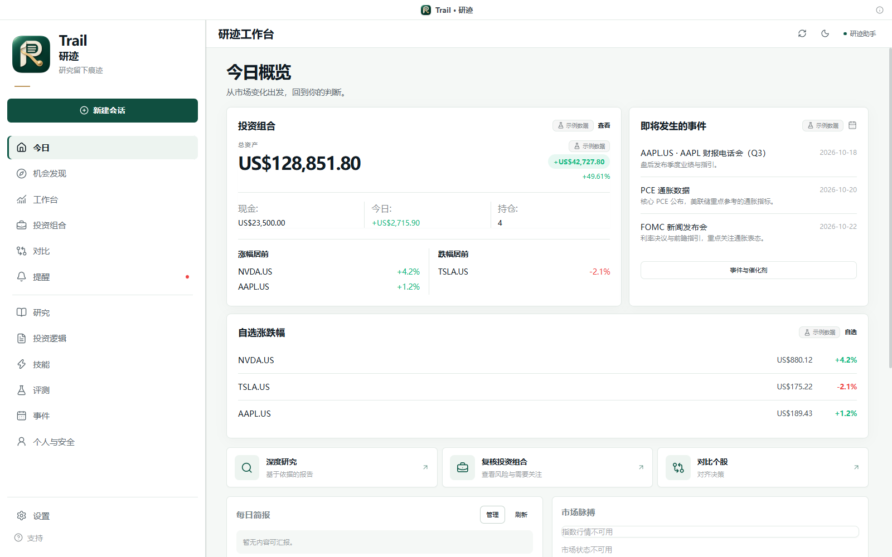
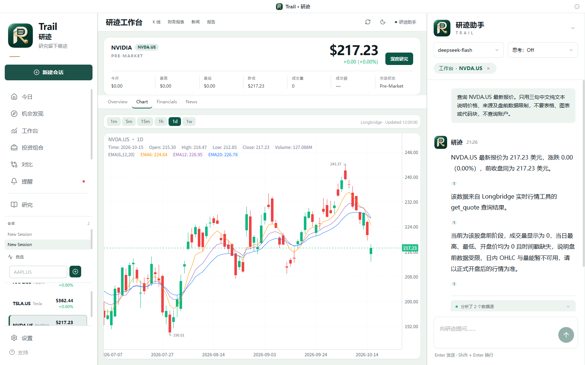
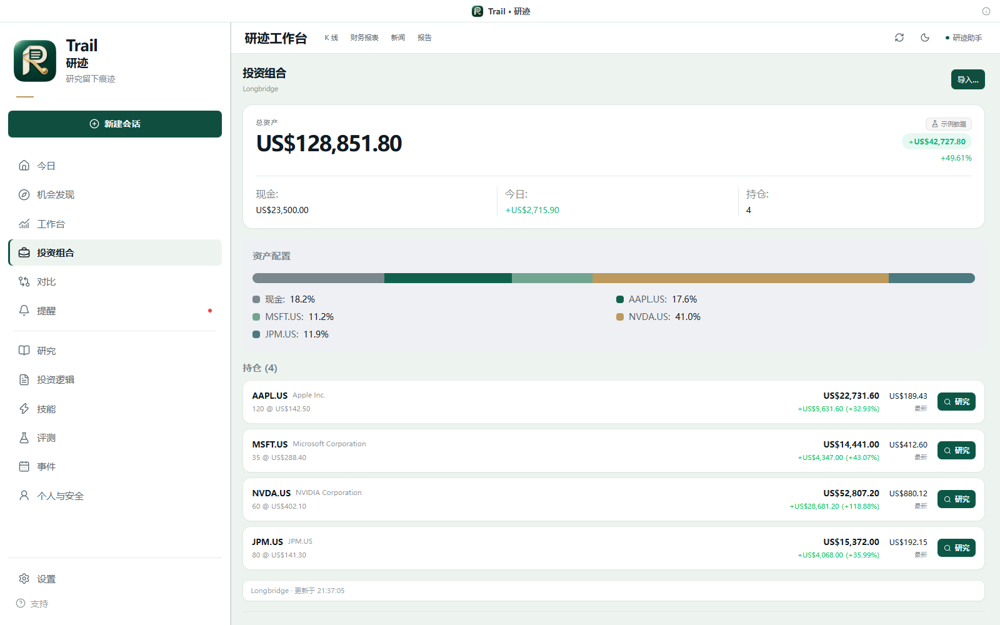
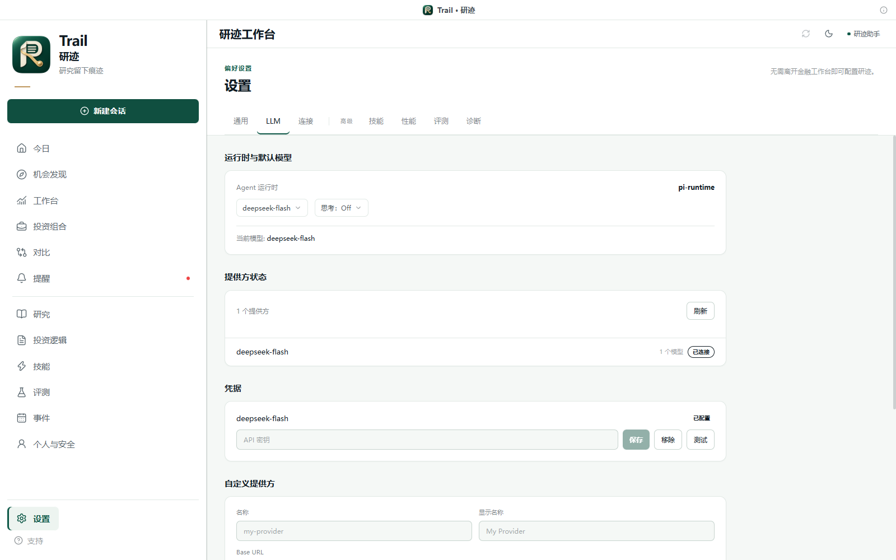
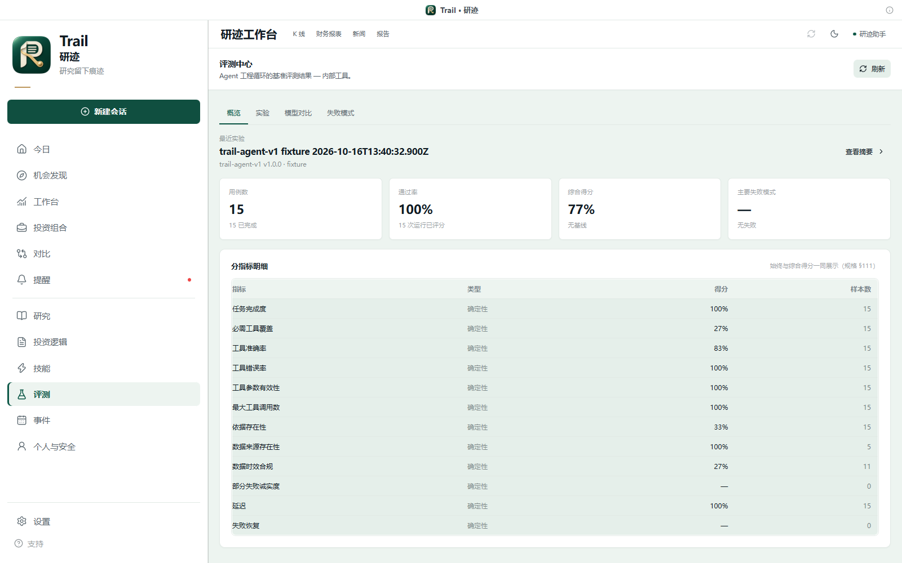
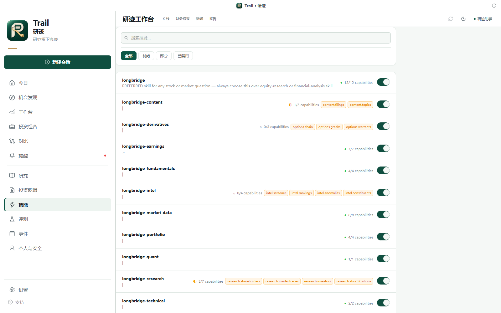
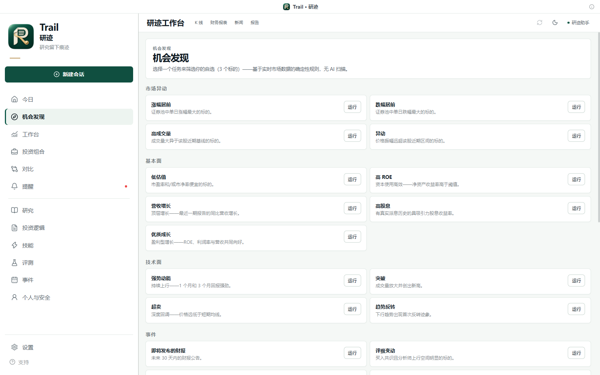

<h1 align="center">Trail · 研迹</h1>

<p align="center">
  
</p>

<p align="center">
  English · <a href="README.md">简体中文</a>
</p>

<p align="center">
  <strong>Local-first AI-native investment research workbench</strong><br />
  Research the market, understand your exposure, and keep an evidence-backed view of what changed.
</p>

<p align="center">
  <a href="https://github.com/ydflow/Trail/releases">Releases</a> ·
  <a href="docs/architecture.md">Architecture</a> ·
  <a href="docs/PRD.md">Product requirements</a>
</p>

> In one line: a market terminal tells you **What happened**; Trail's agent helps you answer **Why does this matter to you**, records **What did you believe before**, and keeps tracking **What changed**.

## About the name

**研迹 (yán jì) ＝ 研 (research) ＋ 迹 (traces).** Research that leaves a trace.

The market produces new data every day. What is actually scarce is not the data — it is *why I made that call last time* and *which assumption the latest change just invalidated*. Trail treats the research process itself as a first-class citizen: every study, every piece of evidence, and every revised thesis leaves a trace you can walk back.

The English name **Trail** carries the same idea — a path that has been walked, and can be walked again.

## Our product

Trail is a desktop research environment for public-market investors. It pairs a quiet, tidy financial workspace with an agent copilot — one that can pull structured market data, explain the evidence, and carry research forward into theses, alerts, and portfolio decisions.

Trail is local-first: sessions, credentials, and research state live on your device by default. Market data and model providers are explicit integrations, not hidden dependencies.

> Trail is a research and decision-support tool. It is read-only by design and provides no order placement or trading capability.

## Screenshots

<p align="center">
  
</p>

<p align="center">
  <em>Today — portfolio attention items, market pulse, events, and quick research actions.</em>
</p>

<p align="center">
  
  
</p>

<p align="center">
  
  
</p>

<p align="center">
  
  
</p>

<p align="center">
  
  
</p>

<p align="center">
  <em>From the securities workspace and events &amp; catalysts through the portfolio overview, the settings hub, skill status, and evaluation tracking — with no service connected, all of the above render fully on built-in sample data (marked with a “Sample data” badge).</em>
</p>

## Core capabilities

### Research workspace

- Watchlists, quotes, K-line charts, financials, news, and security overviews.
- Three-column desktop layout: navigation, market workspace, and agent copilot; a persistent asset tab strip (K-line / statements / news / reports) switches your view from anywhere.
- Compare 2–4 securities across valuation, growth, margins, ROE, dividends, returns, ratings, and momentum.
- Data freshness is visible; missing values show as `—` and are never guessed.

### Sample data out of the box (offline fallback)

- Without a market-data provider or LLM, Today, the portfolio overview, market pulse, events, and the daily brief render built-in sample data — the app is complete from first launch.
- Every sample item carries a prominent “Sample data” badge (with a setup-guidance tooltip); the underlying error state is preserved and real data replaces samples as soon as it is available.
- Symbols outside the sample set (for example `0700.HK`) stay in an honest empty/error state. Numbers are never invented.

### Deep research

- Start research from a focused security in one action.
- Parallel capability calls: bounded concurrency, timeouts, cancellation, and honest partial-failure states.
- Structured data pack → agent synthesis → evidence-backed `ResearchReport`.
- Reports carry stance, confidence, sections, bull case, bear case, catalysts, risks, and a link from every claim to the capability execution record behind it.

### Agent copilot

- Persistent sessions and streamed answers powered by the Pi agent runtime.
- Model and reasoning-level controls, stop/cancel, workspace context, and structured quote/portfolio cards.
- Markdown answers support headings, lists, tables, links, and code blocks.
- Internal synthesis sessions never appear in the visible conversation history.

### Agent evaluation and observability

- Built-in Evaluation Center: experiments, baselines, model comparisons, failure modes, case detail, and human feedback.
- Evaluations cover task completion, tool choice and arguments, evidence/provenance, latency, failure recovery, research completeness, and decision usefulness.
- Local offline evaluation plus optional LangSmith tracing; tracing is off by default, and privacy level and API keys are managed separately in settings.
- The `trail-agent-v1` benchmark holds 86 golden-path, hard, long-tail, tool-failure, regression, and adversarial cases; fixed bugs become regression gates.
- PRs run a zero-cost deterministic smoke eval; the full benchmark and model/strategy experiments run on demand or on a schedule.

### Skills and capability layer

- A single capability registry drives provider execution, agent tools, UI availability, and skill readiness.
- Skills declare required and optional capabilities; the skill hub shows ready, partially ready, and disabled states.
- Progressive loading keeps skill instructions and references available without cramming every document into every prompt.
- The agent never claims a capability is available when it is missing.

### Discovery and learning loop

- 17 deterministic screening tasks spanning market moves, fundamentals, technicals, and events.
- Eight research strategies: comprehensive, value, growth, technical, earnings, event-driven, risk review, and income.
- Candidate actions flow with evidence and rationale into research, comparison, and watchlists.
- Research Diff highlights conclusion changes, valuation shifts, new risks, and confidence moves.

### Portfolio, theses, and monitoring

- Portfolio allocation, concentration, Herfindahl index, large positions, earnings, news, drawdown, and exposure signals.
- Save reports as editable investment theses and re-evaluate them against new data.
- Alert rules for price, news, earnings, ratings, dividends, position weight, and drawdown.
- Today consolidates portfolio attention items, watchlist moves, alerts, upcoming events, recent research, and theses due for review.
- A dedicated **Events &amp; Catalysts page**: earnings, macro releases, and central-bank calendars, one click into research with context attached.
- **Profile page**: local workspace health checks (AI / market data / skills / agent runtime) at a glance.

## How it works

```text
Longbridge / Massive providers
              │
              ▼
      Capability Registry
              │
       ┌──────┼───────────────┐
       ▼      ▼               ▼
    Agent   Research        Product UI
    tools   + Theses        + Skills
            + Alerts        + Compare
            + Risk          + Today
              │
              ▼
      Evidence-backed reports
```

The core boundary is deliberately small: providers return normalized data with provenance, capabilities expose typed operations, and product workflows consume those contracts rather than importing vendor-specific code.

## Flexible integrations

- **Market data:** Longbridge is the primary connector for US / Hong Kong / mainland China market data and brokerage portfolio access; Massive is the alternative provider for US equities.
- **Agent runtime:** the Pi runtime for configured LLM providers, plus a deterministic local provider for development and offline golden paths.
- **Desktop:** Electron, with a packaged macOS arm64 build. Renderer, preload bridge, and main-process kernel are separated through context isolation and a whitelisted IPC surface.
- **Skills:** built-in `SKILL.md` resources with references, enabled/disabled state, triggers, and capability requirements.
- **Agent evaluation:** traces, datasets, evaluators, experiments, and regression gates recorded through a local Evaluation Backend or LangSmith; engineering metrics and investment outcomes stay linkable without claiming causality.

## Quick start

### For users

Download the latest macOS build from the [Releases page](https://github.com/ydflow/Trail/releases). After launching Trail:

1. The full workbench is browsable on first launch — built-in sample data (with a “Sample data” badge) appears before any service is connected.
2. Configure an LLM provider in **Settings → Models**, or use the local provider for a deterministic demo.
3. For live market data and portfolio access, connect Longbridge in **Settings → Connections**; sample data switches to real data automatically once connected.
4. Pick a symbol from a watchlist and open **Deep research**.

Longbridge authentication can also be completed in a terminal:

```bash
longbridge auth login
```

### For developers

Prerequisites: [Bun](https://bun.sh), the [Longbridge CLI](https://open.longbridge.com/longbridge/longbridge-terminal/install) for live data, and an LLM provider for the Pi runtime.

> **Windows**: in a normal (non-administrator) developer terminal, enable Developer Mode first (Settings → System → For developers). Otherwise Bun workspace/symlink installs may produce an empty `node_modules`, a missing `.bin`, or `tsc not found`; processes with symlink privileges or elevated rights are unaffected.

```bash
# Clone and install
git clone https://github.com/ydflow/Trail.git
cd Trail
bun install

# Run the desktop app in development mode
bun run dev

# Deterministic local agent path — no external LLM required
FINAGENT_AGENT_PROVIDER=local bun run dev

# Offline demo mode: fall back to built-in sample data when real providers
# are unavailable (copilot answers annotated as Sample data)
FINAGENT_AGENT_PROVIDER=local FINAGENT_DEMO_DATA=1 bun run dev
```

### Commands

| Command | Description |
| --- | --- |
| `bun run dev` | Start the Electron renderer in development mode |
| `bun test` | Run the full unit and integration suite |
| `bun run typecheck` | Type-check all workspace packages |
| `bun run build` | Build packages, renderer, preload, and main process |
| `bun run test:e2e` | Run the Electron golden-path E2E suite |
| `bun run test:typed-blocks` | Run the real-app copilot E2E for typed answer blocks (apps/electron) |
| `bun run eval:smoke` | Run the PR-level deterministic agent regression eval |
| `bun run eval:full` | Run the full agent benchmark and experiment flow |
| `bun run release:check` | Run release gate checks |
| `bun run release:package` | Build the macOS arm64 app, DMG, and SHA256 checksums |

Packaging output is staged in `dist/release/`.

## Security and product boundaries

- Electron runs with `contextIsolation: true`, `nodeIntegration: false`, and a whitelisted preload bridge.
- API keys and custom provider credentials are encrypted at rest in the main process using Electron `safeStorage`.
- Longbridge commands execute with argv safety, symbol validation, and read-only capability registration.
- Skill asset path safety: path traversal and symlink escapes are rejected.
- Research reports distinguish “data unavailable” from “negative evidence” and never invent missing numbers.
- Agent tracing is off by default; the standard privacy level redacts prompts, answers, arguments, and portfolio tool results, and full tracing must be enabled explicitly.
- Unsigned local builds may trigger macOS security prompts; signing and notarization are optional release-stage steps.

## Project status

Trail is in beta. The repository currently covers the V5 research, discovery, monitoring, results, and adaptive-calibration surfaces, plus a new visual system implementing the Stitch “Minimalist Personal Portfolio” design language: a redrawn sidebar and top workspace bar, the Events &amp; Catalysts and Profile pages, a unified component library with a corner-radius scale, and the offline sample-data fallback.

Agent engineering evaluation (V7) is wired into settings and the Evaluation Center: LangSmith connectivity, privacy controls, benchmark experiments, failure-mode analysis, case-level traces, and human feedback.

- Unit and integration tests: **1157+ passing**
- Type check: **passing**
- Electron E2E and packaging smoke gates: runnable through the release scripts
- Current package channel: `0.4.0-beta.2`

Known limitations and release decisions are recorded in [`docs/release-gates.md`](docs/release-gates.md) ([中文](docs/release-gates.zh-CN.md)) and [`docs/provider-b-decision.md`](docs/provider-b-decision.md) ([中文](docs/provider-b-decision.zh-CN.md)).

## Roadmap

### Near term

- More providers behind the same capability contract.
- Better report navigation and evidence inspection.
- Valuation comparison table (CURRENT vs 5Y AVG) and target-price cards in the securities workspace (see [`docs/design-comparison.md`](docs/design-comparison.md)).
- More useful portfolio-aware research prompts without leaking internal runtime instructions into user conversations.

### Longer term

- Cross-platform packaged builds.
- More research strategies and outcome-calibration samples.
- Richer scheduled briefs, notification channels, and user-defined monitoring rules.
- A skill and provider extension model that is easy for contributors to use.

## Documentation

- [`docs/architecture.md`](docs/architecture.md) — system architecture and runtime boundaries · [中文](docs/architecture.zh-CN.md)
- [`docs/PRD.md`](docs/PRD.md) — product requirements and invariants (Chinese)
- [`docs/UI-SYSTEM.md`](docs/UI-SYSTEM.md) — visual system and component rules · [中文](docs/UI-SYSTEM.zh-CN.md)
- [`docs/longbridge-auth.md`](docs/longbridge-auth.md) — Longbridge authentication · [中文](docs/longbridge-auth.zh-CN.md)
- [`docs/longbridge-skill-setup.md`](docs/longbridge-skill-setup.md) — skill installation and capability coverage · [中文](docs/longbridge-skill-setup.zh-CN.md)
- [`docs/release-gates.md`](docs/release-gates.md) — release verification checklist · [中文](docs/release-gates.zh-CN.md)
- [`docs/EVALUATION.md`](docs/EVALUATION.md) — agent evaluation, LangSmith observability, and experiment architecture · [CI policy](docs/EVALUATION-CI.md) · [Benchmark](docs/EVALUATION-BENCHMARK.md)
- [`docs/design-comparison.md`](docs/design-comparison.md) — screen-by-screen comparison of the Stitch design and the current implementation

## Contributing

Issues and pull requests are welcome. Before submitting changes, run:

```bash
bun test
bun run typecheck
```

For UI changes, include screenshots or a brief visual QA note when layout or interaction changes materially.

---

<p align="center">
  <sub>Trail · 研迹 — research that leaves a trace.</sub>
</p>
