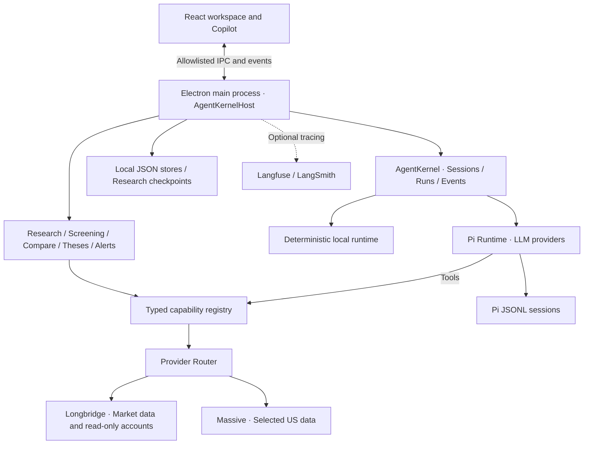

<h1 align="center">Trail · 研迹</h1>

<p align="center"></p>
<p align="center">English · <a href="README.md">简体中文</a></p>
<p align="center">
  <strong>From market signals to investment theses. Keep the evidence behind every decision.</strong><br />
  A local-first AI research desktop connecting market data, charts, agents, evidence and ongoing review.
</p>
<p align="center">
  <a href="#product-preview">Preview</a> · <a href="#core-capabilities">Capabilities</a> ·
  <a href="#quick-start">Quick start</a> · <a href="docs/architecture.md">Architecture</a> ·
  <a href="CONTRIBUTING.md">Contributing</a>
</p>
<p align="center">
  <a href="https://github.com/ydflow/Trail/actions/workflows/pr.yml"></a>
  
  
</p>

## Why Trail

Quotes, news, financial statements and chat answers often live in separate windows. Once research is over, the conclusion survives but its assumptions, source freshness and reasons for revision are harder to reconstruct.

**Trail brings that workflow into one desktop: discover a signal → inspect a security → run research → check evidence → save a thesis → review what changed.** It serves individual public-market researchers and offers an inspectable implementation for developers building agent applications.

**研迹 (yán jì) combines research and traces.** A trail is a research path you can follow again, back to the evidence behind a judgment.

> Beta, with Windows x64 installer and portable downloads. Trail provides read-only research and decision support, with no order placement or automated trading. Model analysis and confidence scores are not guarantees of accuracy or investment returns.

## Product preview

### Deep Research: charts, evidence and judgment in one workspace

<p align="center"></p>

Inspect a security alongside its chart, evidence and decision rail. Completed reports include section findings, risks and catalysts, with an action to save the research as a thesis.

### Securities workspace and AI copilot

<p align="center"></p>

Watchlists, quotes, financials, news and charts share the focused security. The copilot retrieves structured data and streams explanations, with sources accessible beside its answer.

### Inspect the source behind a claim

<p align="center"></p>

Open a citation to inspect values, provider, retrieval time, normalization lineage and snapshot hash. Missing quote timestamps, stale sources and unavailable data retain visible states.

### More workspaces

| Today | Discover |
| --- | --- |
|  |  |
| Watchlist moves, events, briefs and research entry points. | Market, fundamental, technical and event screening tasks. |

| Portfolio | Events & catalysts |
| --- | --- |
|  |  |
| Allocation, holdings and actions to start research. | Earnings and macro events with research context. |

| Skills | Evaluation |
| --- | --- |
|  |  |
| Readiness based on capability dependencies. | Experiments, baselines, failure modes and feedback. |

| Settings | Tracing & privacy |
| --- | --- |
|  |  |
| Models, language, themes, connections and diagnostics. | Optional Langfuse / LangSmith configuration and privacy controls. |

<p align="center"></p>

### Structured answers: quotes, holdings and risk

<p align="center"></p>

| Portfolio holdings table | Portfolio risk comparison |
| --- | --- |
|  |  |

All three answers were executed in the current Electron client with the deterministic local agent and sample data, including source and evidence entry points.

**Screenshot provenance:** These are actual Windows Electron screens built from the current source. Research, the securities workspace and Source Inspector use public Longbridge data and a configured DeepSeek model. Today, Portfolio, Discover and Events use built-in sample content in a separate demonstration profile; balances and holdings are not a real account. Evaluation shows a 15-case offline fixture experiment; Settings shows configuration surfaces. Neither demonstrates live-model quality or verified cloud tracing. Prices, news, report stance and confidence are capture-time snapshots. See the [capture and verification record](docs/screenshots/README.md).

## Core capabilities

### 1. A workspace centered on securities

- Watchlists and security search connect quotes, charts, overview, financials and news.
- Multiple chart periods, OHLCV readouts and moving averages; persistent refresh, light/dark theme and copilot controls.
- The research workspace brings chart, evidence table, stance, confidence, risks and next actions together. Unestablished targets and horizons remain `—`.
- Compare 2–4 securities across valuation, growth, profitability, dividends, ratings and momentum, subject to provider coverage.

### 2. Deep Research: collect facts, then synthesize

- **8 strategies:** comprehensive, value, growth, technical, earnings, event-driven, risk review and income.
- Strategy presets select typed capability plans. Bounded concurrent retrieval feeds agent synthesis, with timeout, cancellation and partial-completion states.
- Reports contain stance, confidence, section verdicts, bull/bear cases, catalysts, risks and links to capability evidence.
- Report history and Research Diff track changes in conclusions, valuation, risks and confidence. Export Markdown or a share card.
- Durable checkpoints save the plan and completed evidence. Interrupted runs can resume, restart or be discarded; resume reuses saved results and retains uncertain-read retry and budget records. [Recovery design](docs/research-recovery.md)

### 3. A context-aware agent copilot

- Pi runtime powers persistent conversations, streaming, model selection, thinking levels and stop controls. A deterministic local runtime supports development and demonstrations.
- The active security, page and selected position supply workspace context.
- Markdown, structured quote/portfolio cards, tool progress and run tracing; invalid structured blocks fall back to text.
- The main process owns sessions, messages and runs, which can reload after restart. Internal research synthesis sessions stay out of the visible chat history.

### 4. Citations and evidence lineage

- Providers normalize financial data into a shared capability contract consumed by both UI and agent tools.
- Citations resolve to tool sources. Source Inspector exposes values, provider, timestamps, freshness, lineage and snapshot hashes.
- Missing data, failed capabilities and partial reports remain explicit, preventing missing evidence from being treated as a negative finding.
- External news is treated as untrusted input. See the [prompt injection defenses and verification scope](docs/security-prompt-injection.md).

### 5. Discovery and ongoing review

- **17 deterministic screening tasks** cover movers, fundamentals, technicals and events. Candidates carry evidence into research, comparison or watchlists. Rules operate on the selected security universe, not an unrestricted market-wide scan.
- Today brings together watchlist moves, market pulse, portfolio attention, alerts, events, recent research and theses due for review.
- Save reports as editable theses and reassess them with new data. Alert rules cover price, news, earnings, ratings, dividends, position weight and drawdown.
- Read-only broker portfolio access and manual imports support allocation, concentration, large positions, exposure and risk review.

### 6. Extension and evaluation surfaces

- A single capability registry connects providers, agent tools, research workflows, UI and skill readiness.
- `SKILL.md` packages declare dependencies, support enable/disable and load instructions and references progressively.
- Evaluation Center exposes experiments, baselines, model comparisons, failure modes, case details and feedback. The `trail-agent-v1` dataset contains **86 cases**, alongside a separate Deep Research gold dataset.
- Fixture evaluation and live-model experiments are separate validation modes. Langfuse / LangSmith tracing is optional; evaluation workflows currently run manually. [Evaluation](docs/EVALUATION.md) · [Langfuse integration](docs/langfuse-tracing.md)

## How it works



**The main process owns business state; the renderer presents it.** React/Jotai acts as the view layer behind an allowlisted preload bridge. Providers integrate through shared capability contracts, with vendor details contained in adapters. Sessions and research use local file persistence; credentials are managed in the main process with Electron `safeStorage` encryption. [Architecture](docs/architecture.md)

| Directory | Responsibility |
| --- | --- |
| `apps/electron` | Main process, preload, renderer entry and E2E |
| `packages/core` | Domain models and capability/provider contracts |
| `packages/shared` | Kernel, runtimes, storage, research and product services |
| `packages/ui` | React/Jotai workbench, charts and copilot |
| `packages/longbridge-tools` | Longbridge CLI execution, validation and integration |
| `packages/pi-extension` | Pi tools and synthesis boundary |
| `packages/skill-hub` · `skills` | Skill discovery, dependencies and progressive loading |
| `packages/i18n` | Chinese/English resources and language preferences |

## Quick start

### Windows downloads

Get **v0.4.0-beta.2**: [Installer](https://github.com/ydflow/Trail/releases/download/v0.4.0-beta.2/Trail-0.4.0-beta.2-windows-x64-setup.exe) · [Portable](https://github.com/ydflow/Trail/releases/download/v0.4.0-beta.2/Trail-0.4.0-beta.2-windows-x64-portable.exe) · [Release notes and SHA-256](https://github.com/ydflow/Trail/releases/tag/v0.4.0-beta.2).

These Windows packages are unsigned; Windows may report an unknown publisher. Install [Bun](https://bun.sh) and configure a model for AI features; install and authorize Longbridge CLI separately for market data. The desktop app, 13 skills and Pi extensions are included. Pi may download its runtime on first use. See the [Windows release record](docs/releases/v0.4.0-beta.2-windows.md).

### Run from source

Install Git, [Bun](https://bun.sh) and Node.js (used by Electron E2E scripts). The current version is `0.4.0-beta.2`, available as source and Windows packages.

```bash
git clone https://github.com/ydflow/Trail.git
cd Trail
bun install
bun run build:electron
```

**Windows CMD:**

```cmd
start-trail.cmd
```

The launcher discovers Longbridge in its standard user directory and prefers a native `bunx.exe` that Pi subprocesses can execute. Bun workspace installation on Windows needs symlink permissions; enabling Developer Mode is recommended.

**macOS / Linux source entry point:**

```bash
FINAGENT_FORCE_PROD_LOAD=1 bunx electron apps/electron/src/main/index.js
```

This is a source launch command, not cross-platform packaging acceptance. `bun run dev` starts only the Vite renderer server. For hot reload, run `bunx electron apps/electron/src/main/index.js` in another terminal with `FINAGENT_FORCE_PROD_LOAD` unset. Opening Vite in a regular browser does not provide the full Electron IPC bridge.

### Connect a model and market data

1. Configure, test and select a model under **Settings → LLM**. Built-in and custom compatible providers are supported; the Pi CLI/runtime must be executable by the current process.
2. Install the official [Longbridge CLI](https://open.longbridge.com/longbridge/longbridge-terminal/install), then authorize it through **Settings → Connections** or `longbridge auth login`.
3. Open a security from the watchlist, inspect its chart or enter **Research**, choose a strategy and start Deep Research.
4. Inspect report evidence or chat sources, then save a judgment as a **Thesis** for later review.

Some product surfaces fall back to built-in samples before services are connected. Data outside sample coverage keeps an empty/error state. Real market coverage, delay, financials and account permissions depend on the provider and account authorization.

For a deterministic local agent on Windows CMD:

```cmd
set "FINAGENT_AGENT_PROVIDER=local"
start-trail.cmd
```

Optionally set `FINAGENT_DEMO_DATA=1` for capability-level sample fallback when real providers are unavailable. Clear these variables to return to the configured live runtime.

### Development commands

| Command | Purpose |
| --- | --- |
| `bun run dev` | Vite renderer development server |
| `bun run build` | Workspace packages and Electron build |
| `bun run typecheck` | Workspace type checking |
| `bun run test:unit` | Isolated unit/integration suite |
| `bun run test:e2e` | Electron golden-path E2E |
| `bun run --cwd apps/electron test:typed-blocks` | Structured answer block Electron verification |
| `bun run i18n:check` | Chinese/English resource parity |
| `bun run eval:smoke -- --mode fixture` | Deterministic offline evaluation |
| `bun run eval:full` | Full evaluation entry; live mode requires separate configuration |
| `bun run release:check` | Release gates |
| `bun run release:package` | Current macOS arm64 packaging workflow |

## Engineering and current boundaries

- **Local-first:** sessions, messages, reports and checkpoints live on the device. Configured models, market providers and enabled tracing still receive their respective requests; local-first does not mean all processing is offline.
- **Desktop isolation:** context isolation, disabled Node integration, sandboxing and an allowlisted preload bridge. Credentials stay in the main process.
- **Recoverable execution:** checksummed checkpoints, atomic writes, saved-evidence reuse, configuration identity checks and persistent budgets. Remote reads may be retried; neither exactly-once execution nor every power-loss scenario is guaranteed.
- **Inspectable output:** tool progress, source inspection, report export and optional tracing. Tracing defaults off, with separate privacy and credential settings.
- **Visible gaps:** live research can be partial. Pre-market, delayed and timestamp-free quotes require source context. Model output can trigger structured-block fallback, and report language depends on the model response.
- **Delivery scope:** Windows x64 Beta installer and portable builds have been checked for installation outside the repo, a live-model quote response and persistent records; see the [Windows release record](docs/releases/v0.4.0-beta.2-windows.md). Windows packages are unsigned. macOS arm64 packaging is configured, with no accepted installer for this version. Product screenshots have a separate [verification record](docs/screenshots/README.md).

## Documentation and contributing

| Document | Contents |
| --- | --- |
| [Architecture](docs/architecture.md) | Processes, kernel, IPC, runtimes and persistence |
| [Product requirements](docs/PRD.md) · [UI system](docs/UI-SYSTEM.md) | Product goals and interface conventions |
| [Longbridge auth](docs/longbridge-auth.md) · [Skill setup](docs/longbridge-skill-setup.md) | Provider and capability configuration |
| [Research recovery](docs/research-recovery.md) · [Existing acceptance report](docs/research-recovery-test-report.md) | Recovery design and distinct validation layers |
| [Evaluation](docs/EVALUATION.md) · [Benchmark](docs/EVALUATION-BENCHMARK.md) | Datasets, evaluators and experiments |
| [Langfuse tracing](docs/langfuse-tracing.md) | Optional tracing and privacy boundaries |
| [Release gates](docs/release-gates.md) · [Provider coverage](docs/provider-b-decision.md) | Delivery checks and known limits |
| [Contributing](CONTRIBUTING.md) | Commit conventions, test evidence and screenshots |

Issues and focused contributions are welcome around provider adapters, research quality, evidence inspection, desktop interaction and reproducible regressions. Priorities include broader provider coverage, report reading/comparison, more reliable model output contracts and cross-platform distribution.

---

<p align="center"><sub>Trail · 研迹 — Research that leaves a trace.</sub></p>
