<h1 align="center">Trail · 研迹</h1>

<p align="center"></p>
<p align="center"><a href="README.en.md">English</a> · 简体中文</p>
<p align="center">
  <strong>从市场线索到投资判断，让每一次研究都有迹可循。</strong><br />
  本地优先的 AI 投资研究桌面工作台，连接行情、图表、Agent、证据与持续复核。
</p>
<p align="center">
  <a href="#产品预览">产品预览</a> · <a href="#核心功能">核心功能</a> ·
  <a href="#快速开始">快速开始</a> · <a href="docs/architecture.zh-CN.md">系统架构</a> ·
  <a href="CONTRIBUTING.md">参与贡献</a>
</p>
<p align="center">
  <a href="https://github.com/ydflow/Trail/actions/workflows/pr.yml"></a>
  
  
</p>

## 为什么做研迹

价格、新闻、财报和聊天回答往往散落在不同窗口里。研究完成后，留下的通常只有一句结论：当时依据什么、哪些数据已经过时、下一次变化是否推翻原判断，都需要重新整理。

**研迹把这条工作链放回同一个桌面：发现线索 → 查看证券 → 发起研究 → 核验证据 → 保存投资逻辑 → 持续复核。** 面向需要反复研究公开市场标的的个人投资者，也为 Agent 应用开发者提供一套可检查的桌面工程实现。

**研迹＝研＋迹。研究留下痕迹。** Trail 既是一条研究路径，也是一条能回头核验的证据轨迹。

> 当前为 Beta，提供 Windows x64 安装版与便携版。Trail 提供只读研究与决策支持，不提供下单或自动交易。模型分析与置信度不代表投资收益或正确率保证。

## 产品预览

### 深度研究：行情、证据与判断，在同一工作区

<p align="center">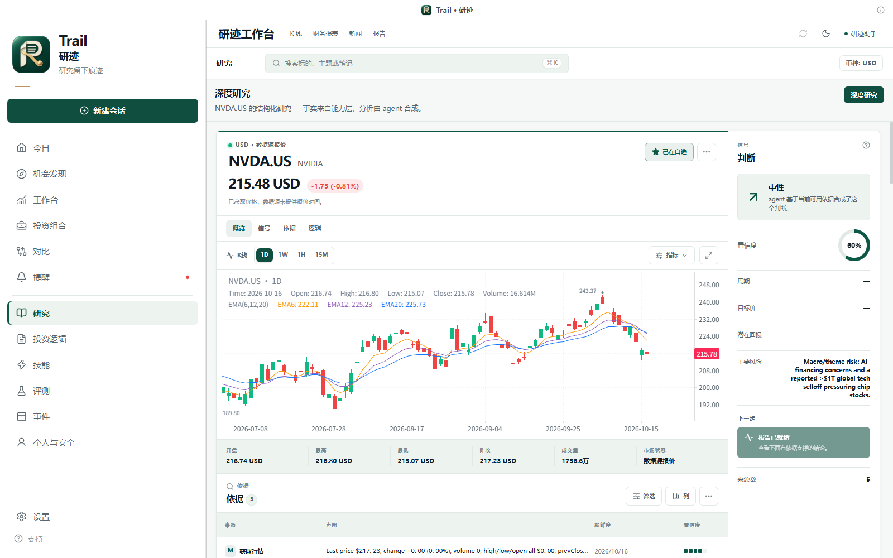</p>

以证券为中心展开 K 线、研究依据和判断侧栏；报告完成后可以查看分项结论、风险、催化剂，并继续保存为投资逻辑。

### 证券工作台与 AI 副驾驶

<p align="center">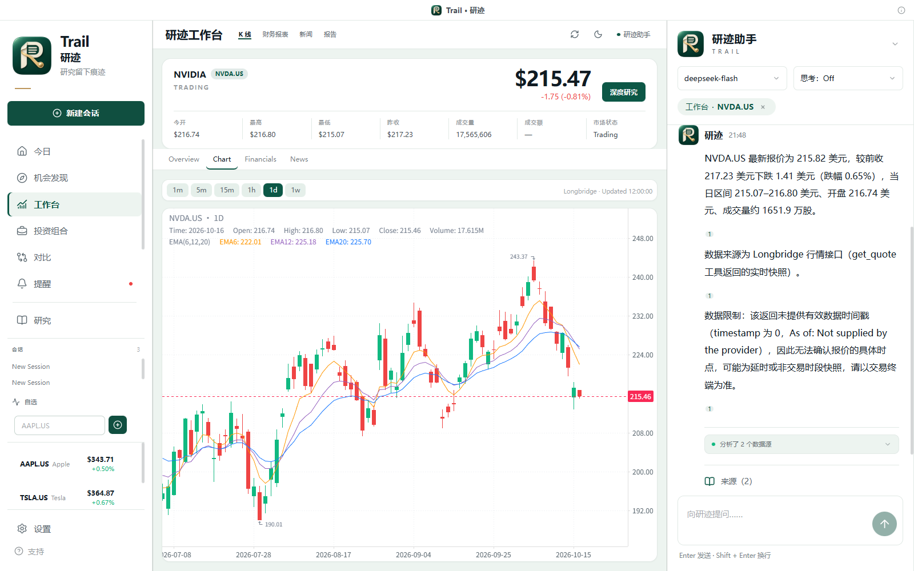</p>

自选、报价、财务、新闻与图表共享当前证券上下文。右侧助手可以读取结构化数据，以流式回答补充解释；来源入口保留在回答旁边。

### 数据来源可以打开检查

<p align="center">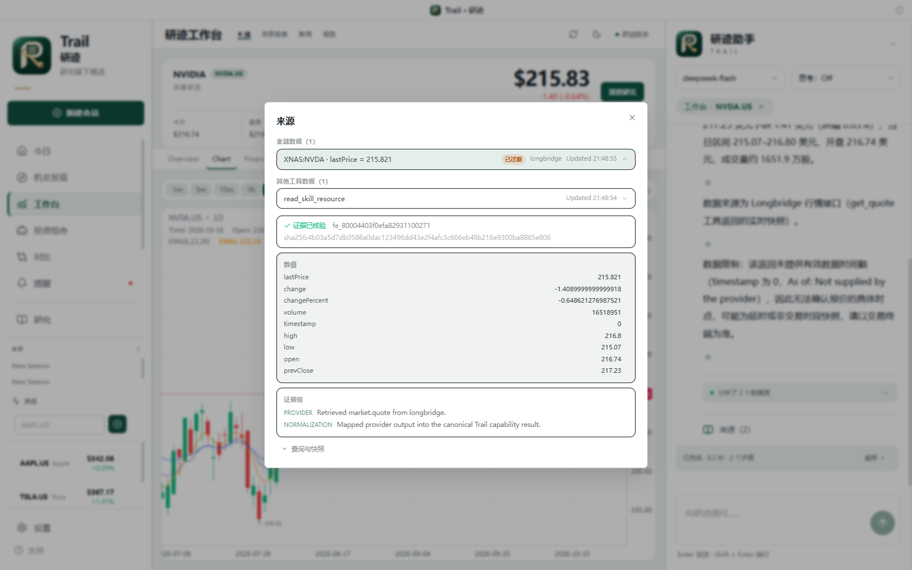</p>

从引用进入来源检查器，查看数值、提供商、获取时间、规范化链路与快照哈希。价格时间缺失、来源过期与数据不可用会保留在可见状态中。

### 更多工作区

| 今日概览 | 机会发现 |
| --- | --- |
|  | 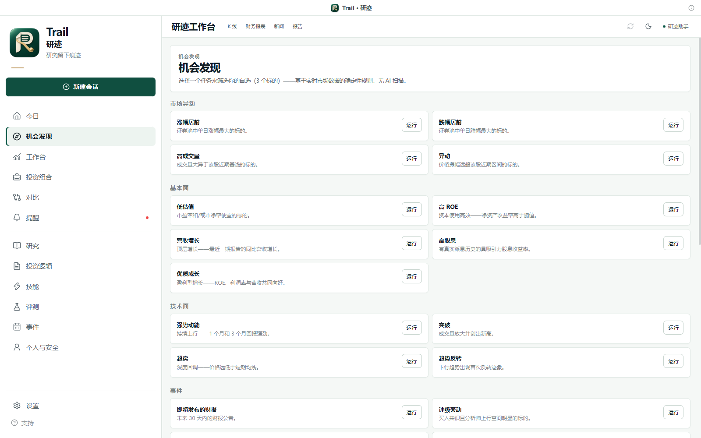 |
| 自选异动、事件、简报与下一步研究入口。 | 按市场、基本面、技术与事件组织筛选任务。 |

| 投资组合 | 事件与催化剂 |
| --- | --- |
| 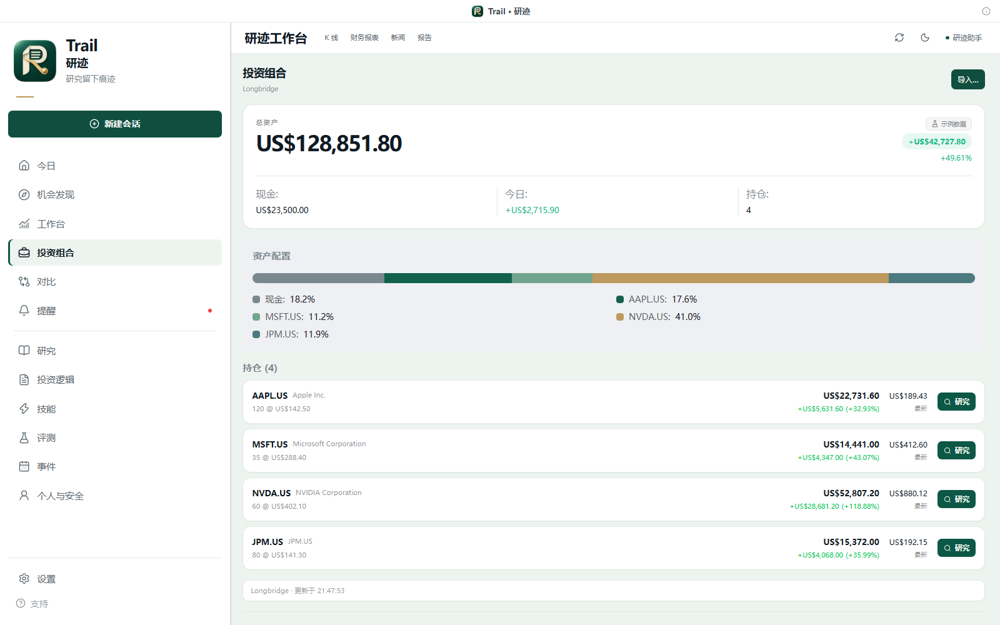 | 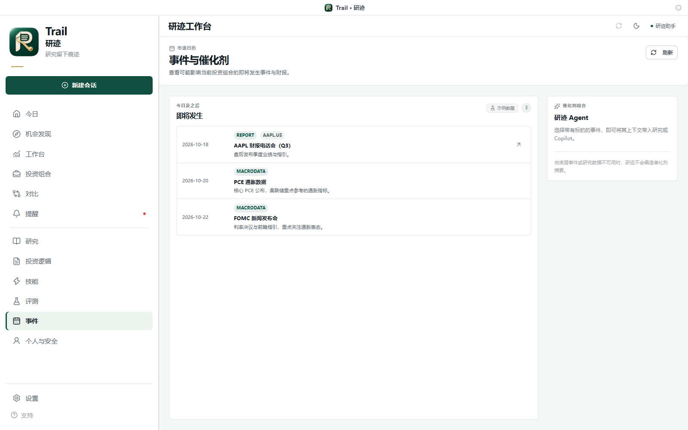 |
| 资产配置、持仓和进入研究的操作。 | 财报、宏观事件与研究上下文。 |

| 技能中心 | 评测中心 |
| --- | --- |
|  | 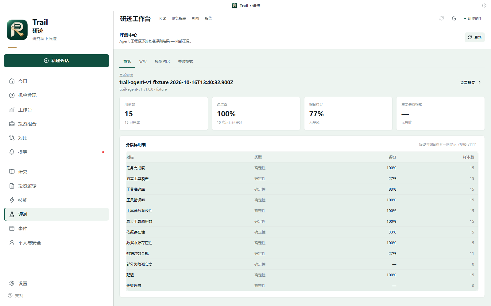 |
| 按能力依赖显示技能就绪情况。 | 实验、基线、失败模式与人工反馈入口。 |

| 设置中心 | 追踪与隐私设置 |
| --- | --- |
|  | 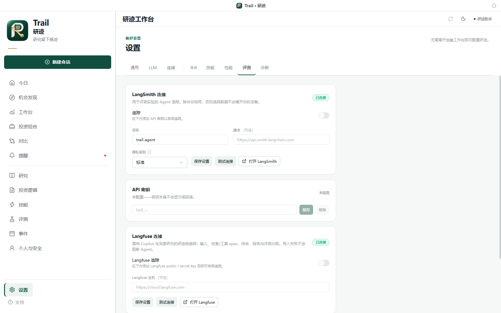 |
| 模型、语言、主题、连接与诊断。 | 可选 Langfuse / LangSmith 连接与隐私控制。 |

<p align="center">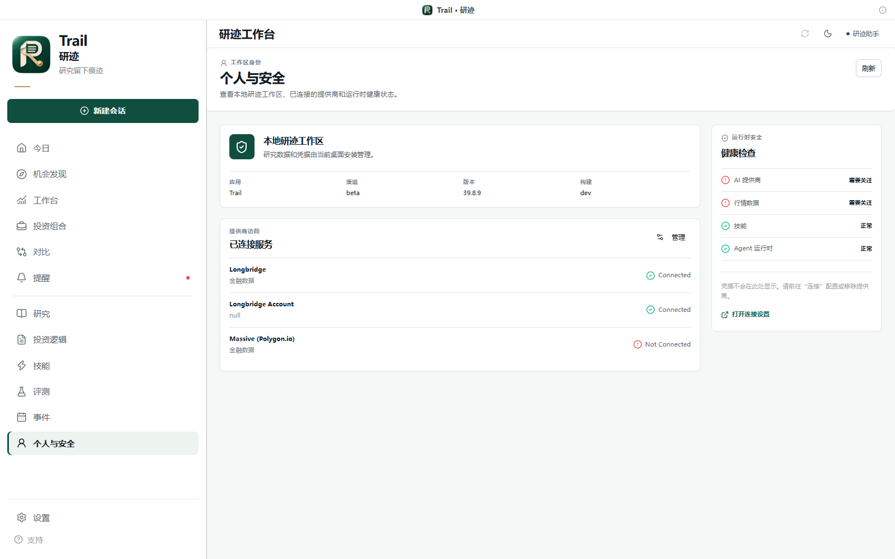</p>

### 结构化回答：行情、组合与风险

<p align="center">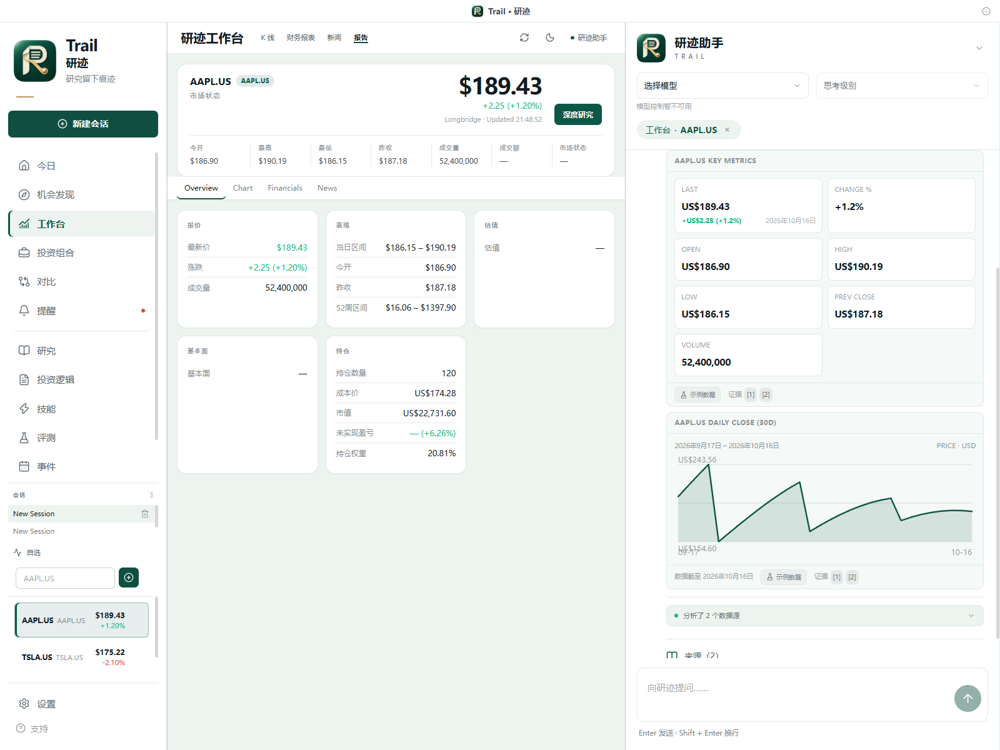</p>

| 组合持仓表 | 组合风险对比 |
| --- | --- |
| 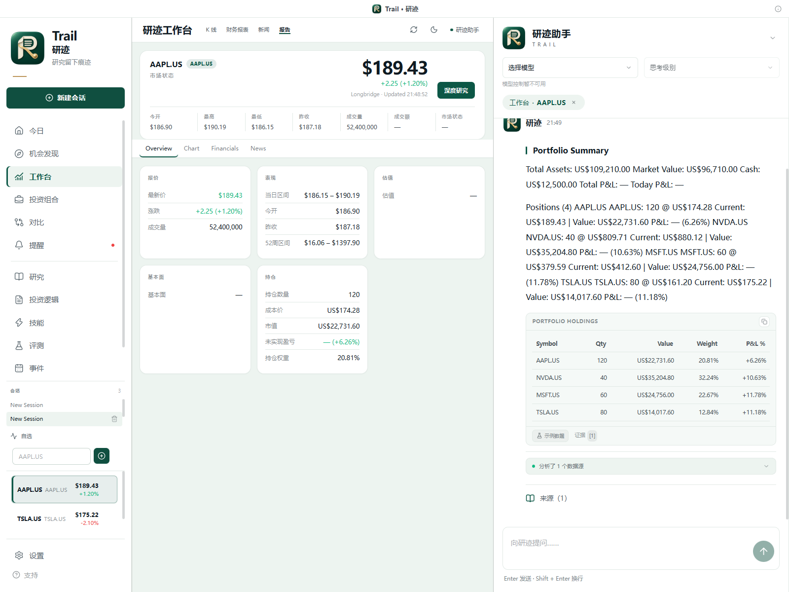 | 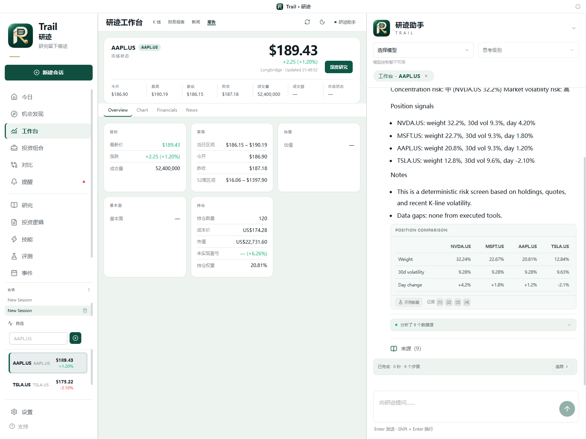 |

以上三种回答均在当前 Electron 客户端实际运行，由本地确定性 Agent 和示例数据生成，包含数据来源与证据入口。

**截图说明：** 以上均来自当前源码构建的真实 Windows Electron 界面。研究、证券工作台与来源检查器使用长桥公开证券数据和已配置的 DeepSeek 模型；今日、组合、发现与事件展示独立演示配置下的内置示例内容，组合金额与持仓不是实际账户资产。评测中心展示 15 个离线 fixture 案例的样例实验；设置图片仅展示配置入口，不代表真实模型质量或云端追踪验收。截图中的价格、新闻、报告立场及置信度均为采集当时的快照，详见[截图记录](docs/screenshots/README.md)。

## 核心功能

### 1. 以证券为中心的研究工作台

- 自选列表与证券搜索，联动报价、K 线、概览、财务和新闻。
- 图表支持多周期、OHLCV 读数与均线；刷新、浅色/深色主题和助手收起入口常驻顶部。
- 新研究界面把图表、依据表、判断、置信度、风险和下一步放在同一视野；未形成结论的目标价、周期等字段保留为 `—`。
- 2–4 只标的横向对比，覆盖估值、成长、盈利能力、股息、评级及动量等维度；可用字段取决于提供商覆盖。

### 2. 深度研究：先收集事实，再综合分析

- **8 种策略**：全面、价值投资、成长、技术面、财报、事件驱动、风险复核、稳健收益。
- 策略选择类型化能力计划，按有界并发获取数据，再交给 Agent 综合；支持超时、取消和部分完成状态。
- 报告包含总体立场、置信度、分项判断、看多/看空理由、催化剂、风险与能力执行依据。
- 报告历史与 Research Diff 支持复查结论、估值、风险和置信度的变化；支持 Markdown 导出及分享卡片。
- 持久化 checkpoint 保存执行计划与已完成依据；意外中断后可以恢复、重新开始或丢弃。恢复会复用已保存的结果，保留不确定请求的重试与预算记录。[恢复机制](docs/research-recovery.md)

### 3. 上下文感知的 Agent 副驾驶

- Pi runtime 驱动持久会话、流式输出、模型切换、思考等级与停止操作；本地确定性 runtime 用于开发和演示。
- 当前证券、页面与选中持仓作为工作区上下文传入，减少反复解释“正在看什么”。
- 支持 Markdown、结构化行情/组合卡片、工具执行状态与运行追踪入口；格式不合法的数据块会降级显示。
- 会话、消息和运行由主进程管理，重启后可重新加载；内部研究综合会话不混入可见聊天记录。

### 4. 引用与证据链

- 金融数据经过提供商规范化和能力层进入 UI 与 Agent，共享同一套数据契约。
- 引用可定位到工具来源；来源检查器展示数值、来源、时间、新鲜度、证据链和快照哈希。
- 缺失数据、失败能力与部分报告保留显式状态，避免把“没有数据”写成“负面结论”。
- 外部新闻按不可信内容处理，相关防护与验证边界见[提示注入防护](docs/security-prompt-injection.md)。

### 5. 从发现线索到持续复核

- **17 个确定性筛选任务**覆盖异动、基本面、技术与事件；候选携带依据和理由进入研究、对比或自选。规则在所选证券范围内运行，不等同于全市场扫描。
- 今日概览聚合自选异动、市场脉搏、组合关注事项、提醒、事件、近期研究与待复核投资逻辑。
- 报告可保存为可编辑的投资逻辑，结合新数据重新评估；提醒覆盖价格、新闻、财报、评级、股息、持仓权重和回撤。
- 投资组合支持券商只读接入与手动导入，查看配置、集中度、大额持仓、敞口及风险信号。

### 6. 能扩展，也能评测

- 单一能力注册表连接提供商、Agent 工具、研究流程、UI 与技能就绪状态。
- `SKILL.md` 技能包声明能力依赖，按需加载指令与参考资料，支持启用/禁用。
- 内置评测中心支持实验、基线、模型对比、失败模式、案例详情与人工反馈；`trail-agent-v1` 基准集含 **86 个案例**，另有深度研究黄金案例集。
- 可运行离线 fixture 评测与真实模型实验；可选 Langfuse / LangSmith 追踪。评测工作流当前为手动触发，离线结果与真实模型结果分别核验。[评测文档](docs/EVALUATION.md) · [Langfuse 接线](docs/langfuse-tracing.zh-CN.md)

## 工作原理

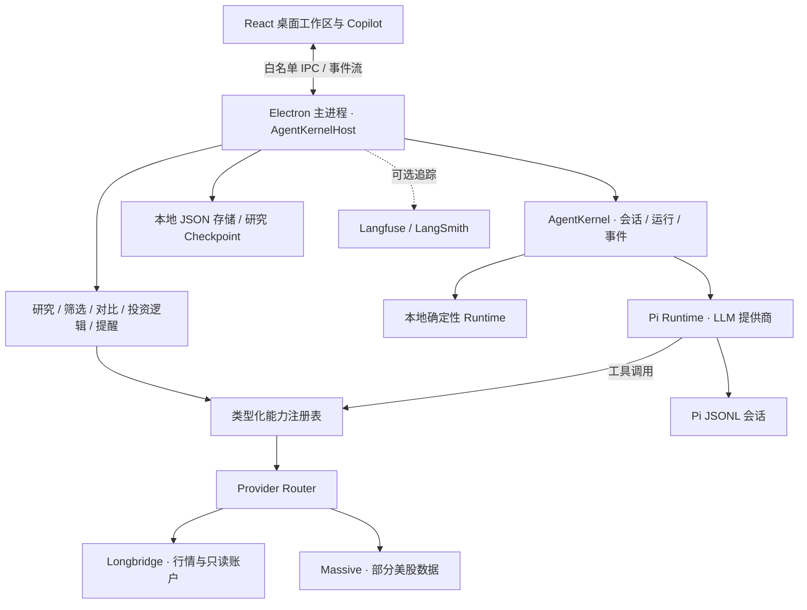

**主进程拥有业务状态，渲染进程负责展示与交互。** React/Jotai 是视图层，预加载桥只暴露白名单接口；市场数据与研究工作流通过统一能力契约衔接提供商，供应商细节留在适配器内。会话和研究采用本地文件持久化，凭证由主进程通过 Electron `safeStorage` 加密管理。[详细架构](docs/architecture.zh-CN.md)

| 目录 | 职责 |
| --- | --- |
| `apps/electron` | 桌面主进程、预加载桥、渲染入口与 E2E |
| `packages/core` | 领域模型、能力与提供商契约 |
| `packages/shared` | 内核、运行时、存储、研究及产品服务 |
| `packages/ui` | React/Jotai 工作台、图表与助手界面 |
| `packages/longbridge-tools` | 长桥 CLI 执行、校验与数据接线 |
| `packages/pi-extension` | Pi 工具与研究综合边界 |
| `packages/skill-hub` · `skills` | 技能发现、依赖与渐进加载 |
| `packages/i18n` | 中英文资源与语言设置 |

## 快速开始

### Windows 下载

下载 **v0.4.0-beta.2**：[安装版](https://github.com/ydflow/Trail/releases/download/v0.4.0-beta.2/Trail-0.4.0-beta.2-windows-x64-setup.exe) · [便携版](https://github.com/ydflow/Trail/releases/download/v0.4.0-beta.2/Trail-0.4.0-beta.2-windows-x64-portable.exe) · [发布说明与 SHA-256](https://github.com/ydflow/Trail/releases/tag/v0.4.0-beta.2)。

安装包尚未进行 Windows 数字签名，系统可能显示发布者未知。AI 功能需安装 [Bun](https://bun.sh) 并配置模型；行情需另行安装和授权 Longbridge CLI。桌面程序、13 个技能及 Pi 扩展已打包，首次启动 Pi 可能需要联网下载运行时。详见 [Windows 发布记录](docs/releases/v0.4.0-beta.2-windows.md)。

### 从源码启动

需要 Git、[Bun](https://bun.sh) 和 Node.js（Electron E2E 脚本使用 Node）。当前版本为 `0.4.0-beta.2`；源码运行与安装包均可使用。

```bash
git clone https://github.com/ydflow/Trail.git
cd Trail
bun install
bun run build:electron
```

**Windows CMD：**

```cmd
start-trail.cmd
```

启动器补齐标准目录中的长桥 PATH，并优先使用可供 Pi 子进程启动的原生 `bunx.exe`。Windows 安装 workspace 依赖时需要符号链接权限，建议先开启系统开发人员模式。

**macOS / Linux 源码运行入口：**

```bash
FINAGENT_FORCE_PROD_LOAD=1 bunx electron apps/electron/src/main/index.js
```

这是源码启动命令，不代表各平台均已通过打包验收。`bun run dev` 只启动 Vite 渲染开发服务器；使用热更新时，另开终端运行 `bunx electron apps/electron/src/main/index.js`，并确保未设置 `FINAGENT_FORCE_PROD_LOAD=1`。普通浏览器打开 Vite 页面无法提供完整 Electron IPC 能力。

### 接入模型与行情

1. 在 **设置 → LLM** 中配置提供商、测试连接并选择模型；支持内置提供商和自定义兼容提供商。Pi CLI/runtime 需可被当前进程启动。
2. 安装官方 [Longbridge CLI](https://open.longbridge.com/longbridge/longbridge-terminal/install)，通过 **设置 → 连接** 完成授权，也可以执行 `longbridge auth login`。
3. 从自选中打开证券，查看 K 线或进入**研究**，选择策略并发起深度研究。
4. 打开报告依据或聊天来源；将需要持续跟踪的判断保存为**投资逻辑**。

未接入服务时，部分产品页提供内置示例回退；不在示例覆盖范围内的数据保留空态或错误。真实市场覆盖、延迟、财务与账户权限取决于提供商和账户授权。

只运行本地确定性 Agent 的 Windows CMD 示例：

```cmd
set "FINAGENT_AGENT_PROVIDER=local"
start-trail.cmd
```

如需能力层的示例数据回退，可另外设置 `FINAGENT_DEMO_DATA=1`；它在真实提供商不可用时生效。停止使用后清除相应环境变量即可切回已配置的真实 runtime。

### 开发与验证命令

| 命令 | 用途 |
| --- | --- |
| `bun run dev` | Vite 渲染开发服务器 |
| `bun run build` | 工作区包与 Electron 构建 |
| `bun run typecheck` | 工作区类型检查 |
| `bun run test:unit` | 隔离执行单元与集成测试 |
| `bun run test:e2e` | Electron 黄金路径 E2E |
| `bun run --cwd apps/electron test:typed-blocks` | 结构化回答块 Electron 验证 |
| `bun run i18n:check` | 中英文资源一致性 |
| `bun run eval:smoke -- --mode fixture` | 离线确定性评测 |
| `bun run eval:full` | 完整评测入口；真实模型模式需要单独配置 |
| `bun run release:check` | 发布门槛检查 |
| `bun run release:package` | 当前 macOS arm64 打包流程 |

## 工程落地与当前边界

- **本地优先：** 会话、消息、报告与 checkpoint 保存在本机。使用外部模型、行情或启用追踪后，相应请求仍会发往配置的服务；本地优先不等于所有处理离线。
- **桌面隔离：** `contextIsolation: true`、`nodeIntegration: false`、沙盒与白名单预加载桥；凭证只在主进程处理。
- **可恢复执行：** checkpoint 校验和、原子写入、已完成依据复用、配置身份检查及持久预算。远端读取可能重试，不承诺 exactly-once 或所有断电场景的数据恢复。
- **可观察、可导出：** 流式工具状态、来源检查器、报告导出与可选追踪；追踪默认关闭，隐私级别和密钥单独配置。
- **诚实的缺口：** 真实研究可能生成部分报告；盘前/延迟/无时间戳报价应结合来源状态理解，不能一概称为实时成交价。模型结构化输出偶尔会触发文本降级，报告语言也受模型输出影响。
- **交付范围：** 已提供 Windows x64 Beta 安装版与便携版，并完成独立目录安装、真实模型行情回答及持久记录检查，见 [Windows 发布记录](docs/releases/v0.4.0-beta.2-windows.md)。Windows 包未签名；macOS arm64 仍为打包配置，未提供本版已验收安装包。产品截图证据见[验证记录](docs/screenshots/README.md)。

## 文档与贡献

| 文档 | 内容 |
| --- | --- |
| [系统架构](docs/architecture.zh-CN.md) · [English](docs/architecture.md) | 进程、内核、IPC、运行时与本地存储 |
| [产品需求](docs/PRD.md) · [UI 系统](docs/UI-SYSTEM.zh-CN.md) | 产品目标与界面规范 |
| [长桥授权](docs/longbridge-auth.zh-CN.md) · [技能接入](docs/longbridge-skill-setup.zh-CN.md) | 数据源和能力配置 |
| [研究恢复](docs/research-recovery.md) · [已有验收报告](docs/research-recovery-test-report.md) | checkpoint 机制与不同验证层级 |
| [Agent 评测](docs/EVALUATION.md) · [基准集](docs/EVALUATION-BENCHMARK.md) | 评测体系、数据集与实验 |
| [Langfuse 追踪](docs/langfuse-tracing.zh-CN.md) | 可选追踪接线与隐私边界 |
| [发布门槛](docs/release-gates.zh-CN.md) · [提供商覆盖](docs/provider-b-decision.zh-CN.md) | 发布检查与已知限制 |
| [贡献指南](CONTRIBUTING.md) | 提交规范、测试报告与截图要求 |

欢迎围绕提供商适配、研究质量、来源核验、桌面体验和可复现回归用例提交 Issue 或 PR。后续重点是更完整的提供商覆盖、研究报告阅读与比较、模型输出契约稳定性，以及跨平台分发。

---

<p align="center"><sub>Trail · 研迹 — 研究留下痕迹。</sub></p>
