<h1 align="center">Trail · 研迹</h1>

<p align="center"></p>
<p align="center"><a href="README.en.md">English</a> · <a href="README.md">简体中文</a> · Türkçe</p>
<p align="center">
  <strong>Piyasa sinyallerinden yatırım tezlerine. Her kararın arkasındaki kanıtı koruyun.</strong><br />
  Piyasa verilerini, grafikleri, ajanları, kanıtları ve sürekli gözden geçirmeyi birleştiren yerel öncelikli (local-first) bir yapay zeka araştırma masaüstü uygulaması.
</p>
<p align="center">
  <a href="#ürün-önizlemesi">Önizleme</a> · <a href="#temel-yetenekler">Yetenekler</a> ·
  <a href="#hızlı-başlangıç">Hızlı Başlangıç</a> · <a href="docs/architecture.md">Mimari</a> ·
  <a href="CONTRIBUTING.md">Katkıda Bulunma</a>
</p>
<p align="center">
  <a href="https://github.com/ydflow/Trail/actions/workflows/pr.yml"></a>
  
  
</p>

## Neden Trail

Fiyat teklifleri, haberler, finansal tablolar ve sohbet yanıtları genellikle ayrı pencerelerde yaşar. Araştırma bittiğinde sonuç kalır, ancak varsayımlar, kaynak güncelliği ve revizyon nedenleri yeniden kurgulanması daha zor hale gelir.

**Trail bu iş akışını tek bir masaüstünde toplar: bir sinyal keşfedin → bir menkul kıymeti inceleyin → araştırma çalıştırın → kanıtları kontrol edin → bir tez kaydedin → nelerin değiştiğini gözden geçirin.** Bireysel halka açık piyasa araştırmacılarına hizmet eder ve ajan uygulamaları geliştiren geliştiriciler için incelenebilir bir uygulama sunar.

**研迹 (yán jì), araştırma ve izleri birleştirir.** Bir iz (trail), bir yargının arkasındaki kanıtlara kadar yeniden takip edebileceğiniz bir araştırma yoludur.

> Beta; Windows x64 yükleyici ve taşınabilir indirmelerle sunulmaktadır. Trail, emir iletimi veya otomatik alım satım olmadan salt okunur araştırma ve karar desteği sağlar. Model analizleri ve güven puanları doğruluk veya yatırım getirisi garantisi değildir.

## Ürün önizlemesi

### Derin Araştırma: grafikler, kanıtlar ve yargı tek çalışma alanında

<p align="center">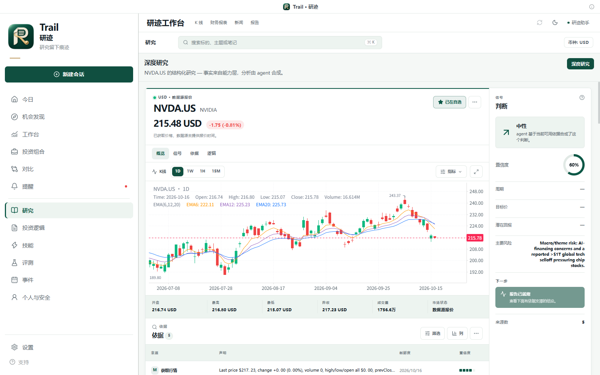</p>

Bir menkul kıymeti grafiği, kanıtları ve karar şeridiyle yan yana inceleyin. Tamamlanan raporlar bölüm bulgularını, riskleri ve katalizörleri içerir; araştırmayı tez olarak kaydetme eylemi sunar.

### Menkul kıymetler çalışma alanı ve yapay zeka yardımcı pilotu

<p align="center">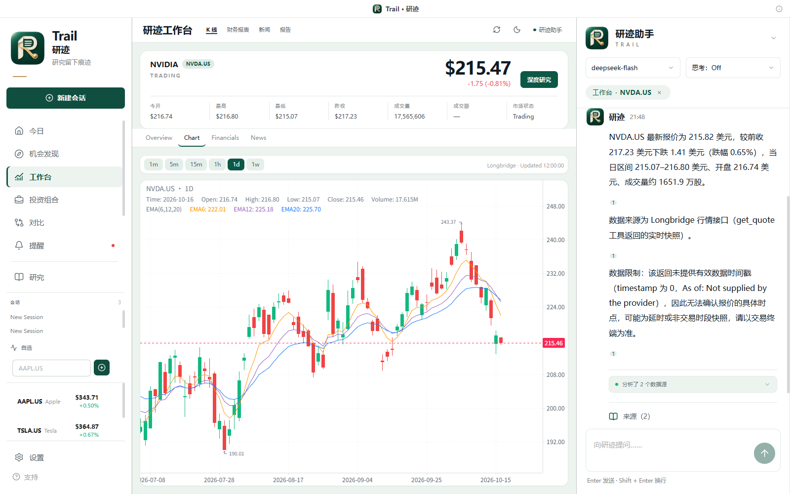</p>

İzleme listeleri, fiyatlar, finansallar, haberler ve grafikler odaklanılan menkul kıymeti paylaşır. Yardımcı pilot yapılandırılmış verileri alır ve açıklamaları akış halinde sunar; yanıtının yanında kaynaklara erişilebilir.

### Bir iddianın arkasındaki kaynağı inceleyin

<p align="center">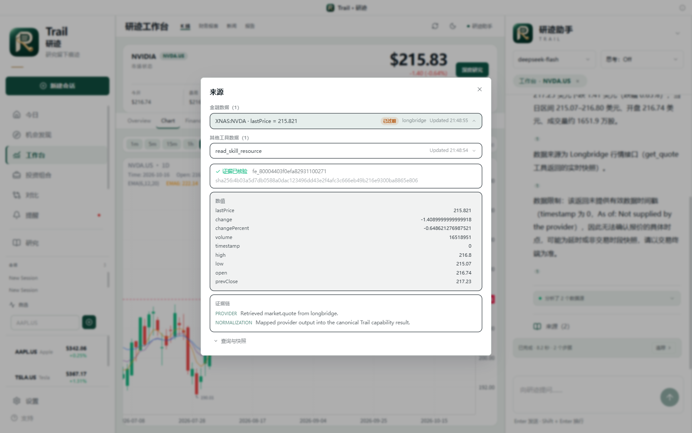</p>

Değerleri, sağlayıcıyı, alma zamanını, normalleştirme soy geçmişini ve anlık görüntü özetini (hash) incelemek için bir alıntıyı açın. Eksik fiyat zaman damgaları, bayat kaynaklar ve kullanılamayan veriler görünür durumlarını korur.

### Daha fazla çalışma alanı

| Bugün | Keşfet |
| --- | --- |
| 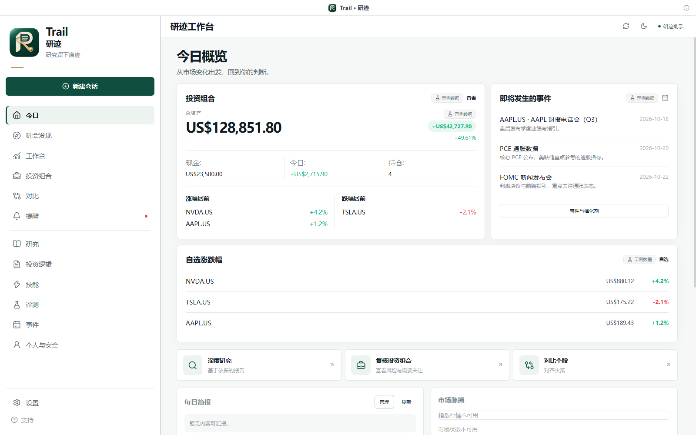 | 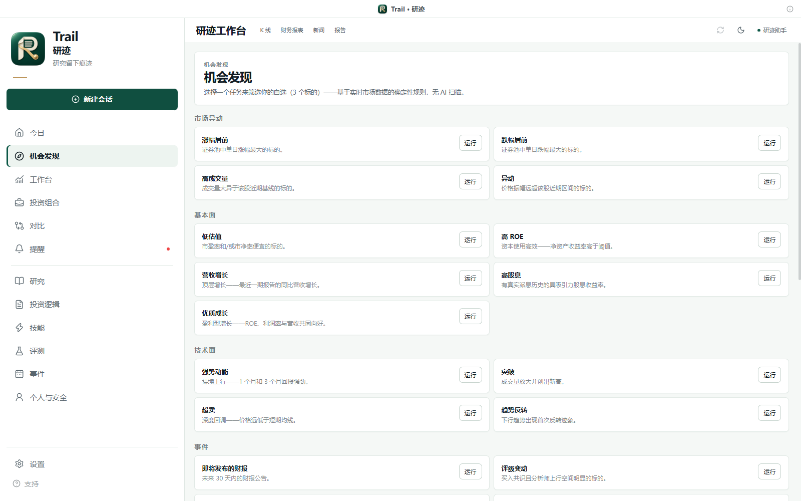 |
| İzleme listesi hareketleri, olaylar, özetler ve araştırma giriş noktaları. | Piyasa, temel, teknik ve olay tarama görevleri. |

| Portföy | Olaylar ve katalizörler |
| --- | --- |
| 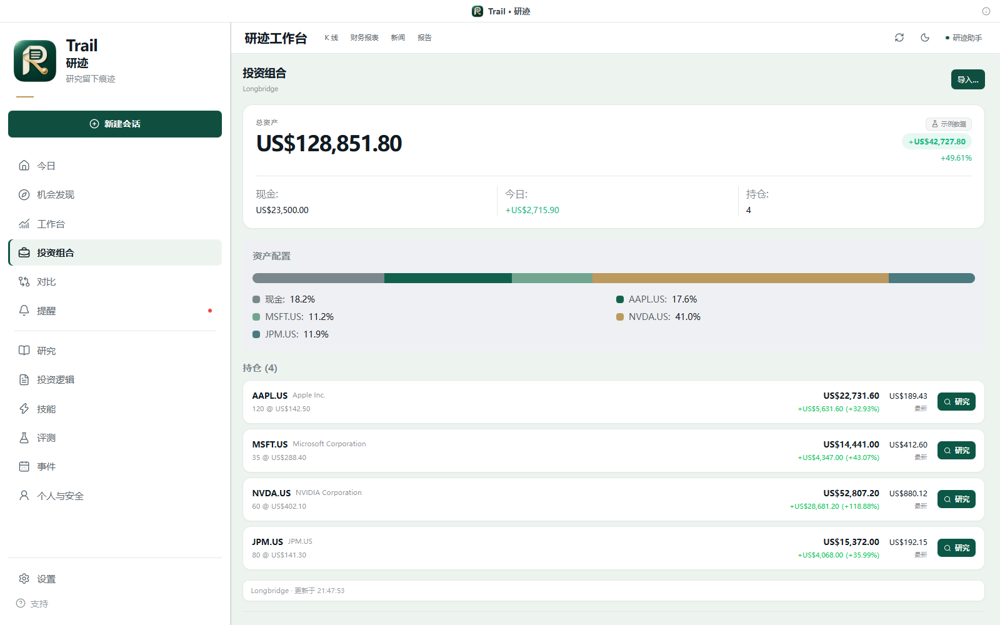 | 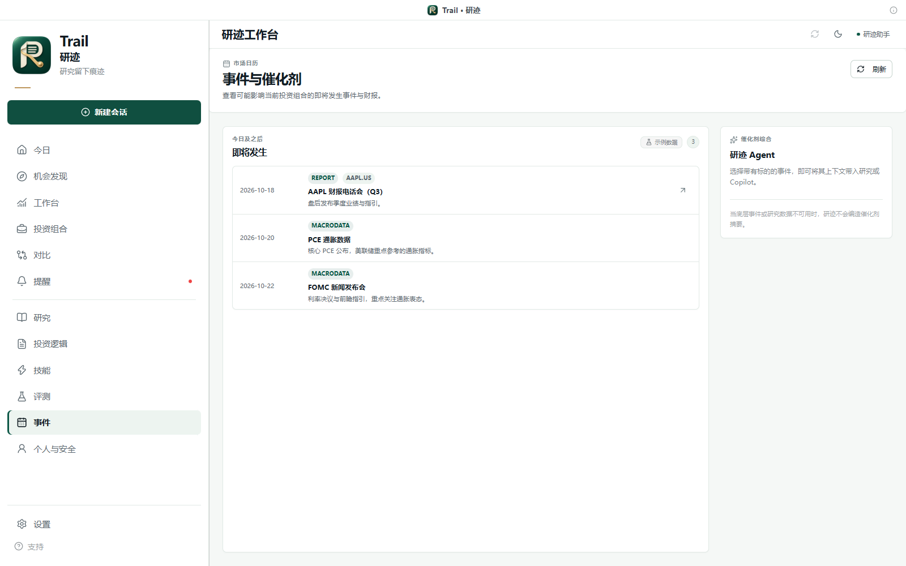 |
| Dağılım, varlıklar ve araştırma başlatma eylemleri. | Araştırma bağlamıyla bilanço ve makro olaylar. |

| Yetenekler (Skills) | Değerlendirme |
| --- | --- |
| 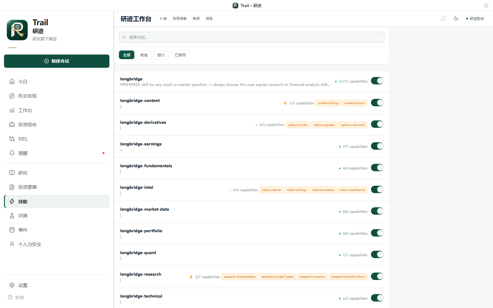 | 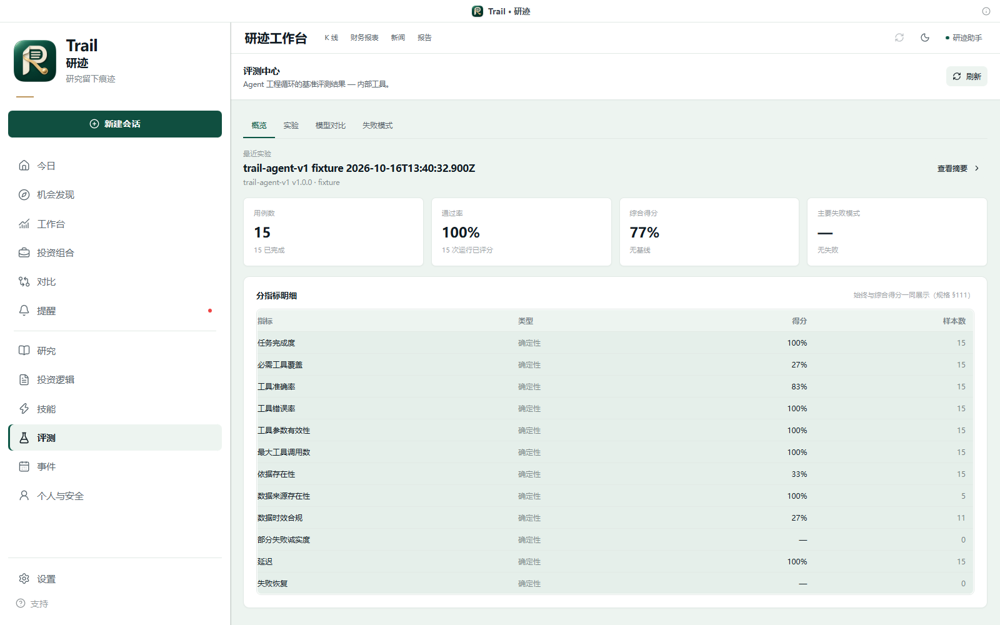 |
| Yetenek bağımlılıklarına dayalı hazırlık durumu. | Deneyler, temel çizgiler, başarısızlık modları ve geri bildirim. |

| Ayarlar | İzleme ve gizlilik |
| --- | --- |
| 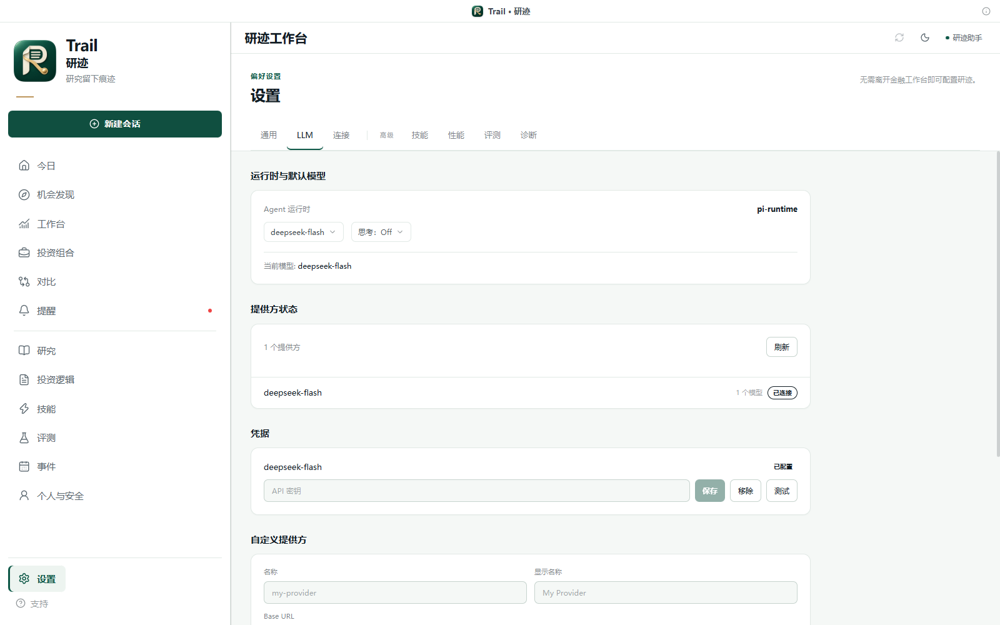 | 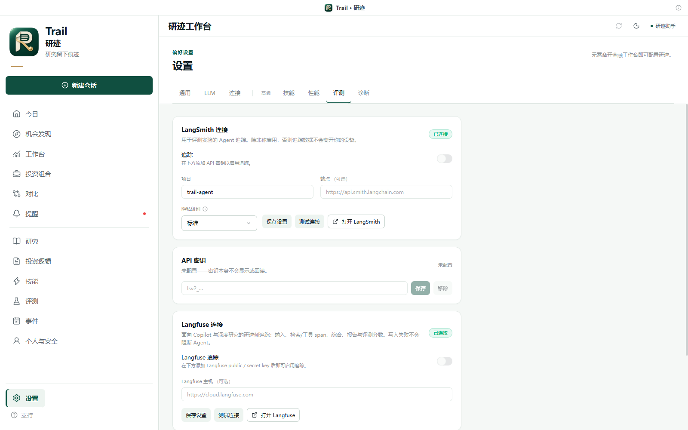 |
| Modeller, dil, temalar, bağlantılar ve tanılama. | İsteğe bağlı Langfuse / LangSmith yapılandırması ve gizlilik denetimleri. |

<p align="center">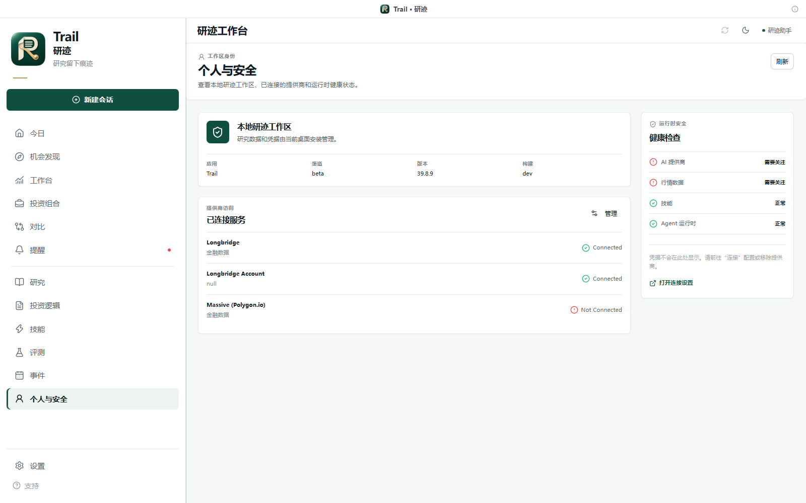</p>

### Yapılandırılmış yanıtlar: fiyatlar, varlıklar ve risk

<p align="center">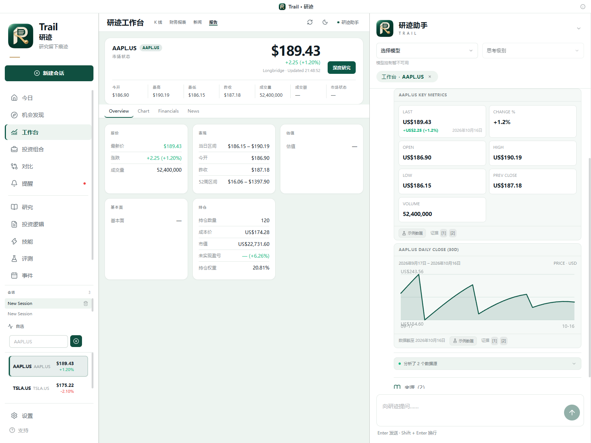</p>

| Portföy varlıkları tablosu | Portföy risk karşılaştırması |
| --- | --- |
| 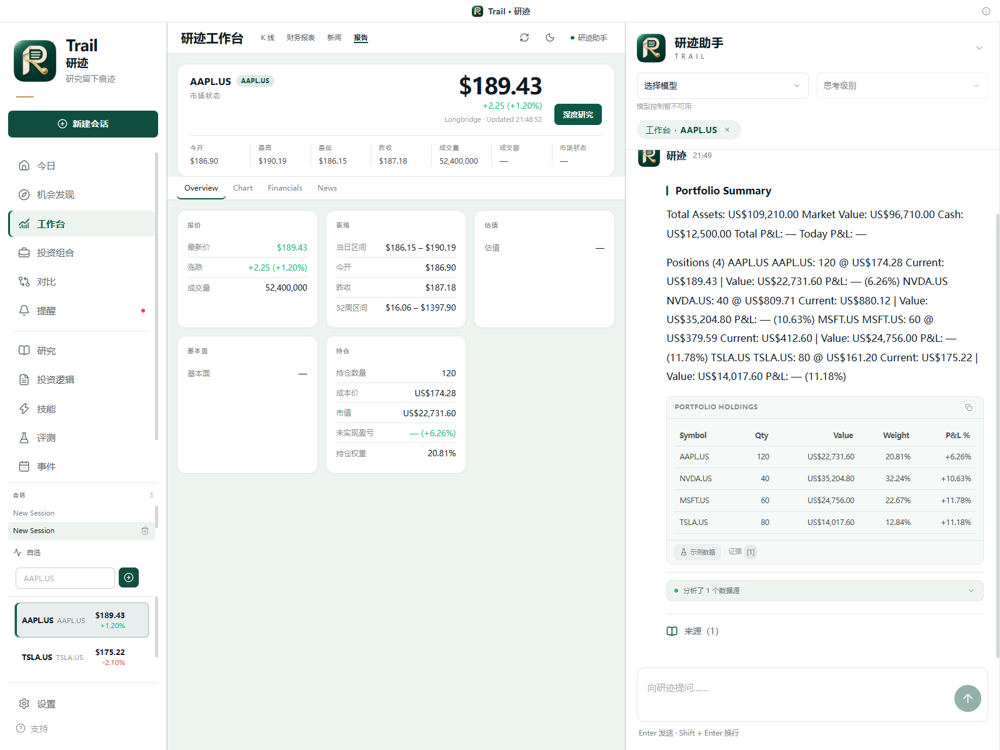 | 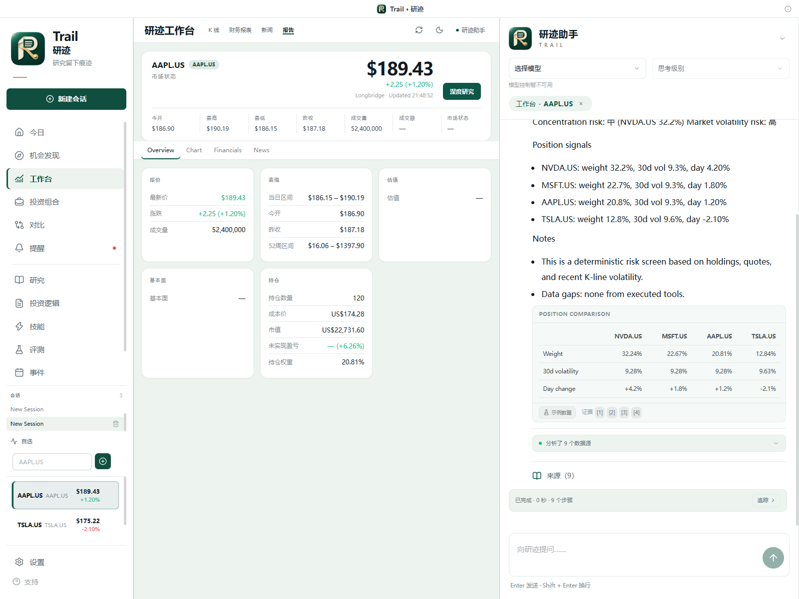 |

Her üç yanıt da kaynak ve kanıt giriş noktaları dahil olmak üzere deterministik yerel ajan ve örnek verilerle mevcut Electron istemcisinde yürütülmüştür.

**Ekran görüntüsü kaynağı:** Bunlar mevcut kaynaktan derlenen gerçek Windows Electron ekranlarıdır. Araştırma, menkul kıymetler çalışma alanı ve Kaynak Denetçisi herkese açık Longbridge verilerini ve yapılandırılmış bir DeepSeek modelini kullanır. Bugün, Portföy, Keşfet ve Olaylar ayrı bir gösterim profilinde yerleşik örnek içerik kullanır; bakiyeler ve varlıklar gerçek bir hesap değildir. Değerlendirme 15 vakalık çevrimdışı bir fikstür deneyini; Ayarlar ise yapılandırma yüzeylerini gösterir. Bunların hiçbiri canlı model kalitesini veya doğrulanmış bulut izlemeyi göstermez. Fiyatlar, haberler, rapor duruşu ve güven puanları yakalama anındaki anlık görüntülerdir. [Yakalama ve doğrulama kaydına](docs/screenshots/README.md) bakın.

## Temel yetenekler

### 1. Menkul kıymetler odaklı bir çalışma alanı

- İzleme listeleri ve menkul kıymet araması; fiyatları, grafikleri, genel bakışı, finansalları ve haberleri birbirine bağlar.
- Birden fazla grafik dönemi, OHLCV okumaları ve hareketli ortalamalar; kalıcı yenileme, açık/koyu tema ve yardımcı pilot kontrolleri.
- Araştırma çalışma alanı grafiği, kanıt tablosunu, duruşu, güveni, riskleri ve sonraki eylemleri bir araya getirir. Belirlenmemiş hedefler ve ufuklar `—` olarak kalır.
- Sağlayıcı kapsamına bağlı olarak 2–4 menkul kıymeti değerleme, büyüme, kârlılık, temettüler, derecelendirmeler ve momentum açısından karşılaştırın.

### 2. Derin Araştırma: önce olguları toplayın, sonra sentezleyin

- **8 strateji:** kapsamlı, değer, büyüme, teknik, bilanço, olay odaklı, risk incelemesi ve gelir.
- Strateji ön ayarları tiplenmiş yetenek planları seçer. Sınırlı eşzamanlı veri çekme, zaman aşımı, iptal ve kısmi tamamlanma durumlarıyla ajan sentezini besler.
- Raporlar duruş, güven, bölüm kararları, boğa/ayı senaryoları, katalizörler, riskler ve yetenek kanıtlarına bağlantılar içerir.
- Rapor geçmişi ve Araştırma Farkı (Research Diff), sonuçlardaki, değerlemedeki, risklerdeki ve güvendeki değişiklikleri izler. Markdown veya paylaşım kartı dışa aktarın.
- Dayanıklı kontrol noktaları (checkpoints) planı ve tamamlanan kanıtları kaydeder. Kesintiye uğrayan çalıştırmalar devam ettirilebilir, yeniden başlatılabilir veya atılabilir; devam ettirme kaydedilen sonuçları yeniden kullanır ve belirsiz okuma yeniden deneme ile bütçe kayıtlarını korur. [Kurtarma tasarımı](docs/research-recovery.md)

### 3. Bağlam farkında bir ajan yardımcı pilotu

- Pi çalışma zamanı kalıcı konuşmaları, akışı, model seçimini, düşünme düzeylerini ve durdurma kontrollerini destekler. Deterministik bir yerel çalışma zamanı geliştirme ve gösterimleri destekler.
- Etkin menkul kıymet, sayfa ve seçili pozisyon çalışma alanı bağlamını sağlar.
- Markdown, yapılandırılmış fiyat/portföy kartları, araç ilerlemesi ve çalıştırma izleme; geçersiz yapılandırılmış bloklar metne geri döner.
- Ana süreç oturumların, mesajların ve çalıştırmaların sahibidir; bunlar yeniden başlatma sonrasında yeniden yüklenebilir. Dahili araştırma sentez oturumları görünür sohbet geçmişinin dışında tutulur.

### 4. Alıntılar ve kanıt soy geçmişi

- Sağlayıcılar finansal verileri hem kullanıcı arayüzü hem de ajan araçları tarafından tüketilen paylaşılan bir yetenek sözleşmesine normalleştirir.
- Alıntılar araç kaynaklarına çözümlenir. Kaynak Denetçisi değerleri, sağlayıcıyı, zaman damgalarını, güncelliği, soy geçmişini ve anlık görüntü özetlerini gösterir.
- Eksik veriler, başarısız yetenekler ve kısmi raporlar açık kalır; eksik kanıtın olumsuz bir bulgu olarak değerlendirilmesi önlenir.
- Harici haberler güvenilmeyen girdi olarak ele alınır. [İstem enjeksiyonu savunmaları ve doğrulama kapsamına](docs/security-prompt-injection.md) bakın.

### 5. Keşif ve sürekli gözden geçirme

- **17 deterministik tarama görevi** hareket edenleri, temelleri, teknikleri ve olayları kapsar. Adaylar kanıtları araştırmaya, karşılaştırmaya veya izleme listelerine taşır. Kurallar kısıtlamasız piyasa geneli bir tarama değil, seçili menkul kıymet evreni üzerinde çalışır.
- Bugün görünümü; izleme listesi hareketlerini, piyasa nabzını, portföy dikkatini, uyarıları, olayları, son araştırmaları ve gözden geçirilmesi gereken tezleri bir araya getirir.
- Raporları düzenlenebilir tezler olarak kaydedin ve yeni verilerle yeniden değerlendirin. Uyarı kuralları fiyat, haberler, bilançolar, derecelendirmeler, temettüler, pozisyon ağırlığı ve düşüşü (drawdown) kapsar.
- Salt okunur aracı kurum portföy erişimi ve manuel içe aktarmalar; dağılım, yoğunlaşma, büyük pozisyonlar, maruziyet ve risk incelemesini destekler.

### 6. Genişletme ve değerlendirme yüzeyleri

- Tek bir yetenek kayıt defteri sağlayıcıları, ajan araçlarını, araştırma iş akışlarını, kullanıcı arayüzünü ve yetenek hazırlığını birbirine bağlar.
- `SKILL.md` paketleri bağımlılıkları bildirir, etkinleştirme/devre dışı bırakmayı destekler ve talimatlar ile referansları aşamalı olarak yükler.
- Değerlendirme Merkezi deneyleri, temel çizgileri, model karşılaştırmalarını, başarısızlık modlarını, vaka ayrıntılarını ve geri bildirimi sunar. `trail-agent-v1` veri kümesi, ayrı bir Derin Araştırma altın veri kümesinin yanında **86 vaka** içerir.
- Fikstür değerlendirmesi ve canlı model deneyleri ayrı doğrulama modlarıdır. Langfuse / LangSmith izleme isteğe bağlıdır; değerlendirme iş akışları şu anda manuel olarak çalışır. [Değerlendirme](docs/EVALUATION.md) · [Langfuse entegrasyonu](docs/langfuse-tracing.md)

## Nasıl çalışır

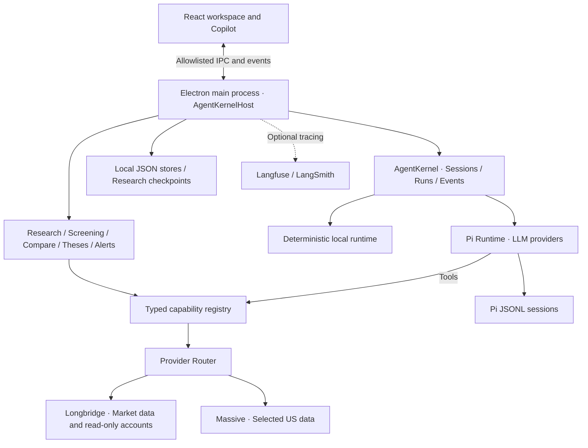

**Ana süreç iş durumuna sahiptir; işleyici (renderer) onu sunar.** React/Jotai, izin listeli bir preload köprüsünün arkasında görünüm katmanı olarak görev yapar. Sağlayıcılar, satıcı ayrıntıları bağdaştırıcılar içinde tutularak paylaşılan yetenek sözleşmeleri üzerinden entegre olur. Oturumlar ve araştırmalar yerel dosya kalıcılığı kullanır; kimlik bilgileri ana süreçte Electron `safeStorage` şifrelemesiyle yönetilir. [Mimari](docs/architecture.md)

| Dizin | Sorumluluk |
| --- | --- |
| `apps/electron` | Ana süreç, preload, renderer girişi ve E2E |
| `packages/core` | Alan modelleri ve yetenek/sağlayıcı sözleşmeleri |
| `packages/shared` | Çekirdek, çalışma zamanları, depolama, araştırma ve ürün hizmetleri |
| `packages/ui` | React/Jotai çalışma tezgahı, grafikler ve yardımcı pilot |
| `packages/longbridge-tools` | Longbridge CLI yürütme, doğrulama ve entegrasyon |
| `packages/pi-extension` | Pi araçları ve sentez sınırı |
| `packages/skill-hub` · `skills` | Yetenek keşfi, bağımlılıklar ve aşamalı yükleme |
| `packages/i18n` | Çince/İngilizce kaynaklar ve dil tercihleri |

## Hızlı başlangıç

### Windows indirmeleri

**v0.4.0-beta.3** sürümünü edinin: [Yükleyici](https://github.com/ydflow/Trail/releases/download/v0.4.0-beta.3-windows/Trail-0.4.0-beta.3-windows-x64-setup.exe) · [Taşınabilir](https://github.com/ydflow/Trail/releases/download/v0.4.0-beta.3-windows/Trail-0.4.0-beta.3-windows-x64-portable.exe) · [Sürüm notları](https://github.com/ydflow/Trail/releases/tag/v0.4.0-beta.3-windows) · [SHA-256](https://github.com/ydflow/Trail/releases/download/v0.4.0-beta.3-windows/SHA256SUMS.txt).

Bu Windows paketleri imzasızdır; Windows bilinmeyen bir yayıncı bildirebilir. [Bun](https://bun.sh) kurun ve yapay zeka özellikleri için bir model yapılandırın; piyasa verileri için Longbridge CLI'yı ayrı olarak kurup yetkilendirin. Masaüstü uygulaması, 13 yetenek ve Pi uzantıları dahildir. Pi ilk kullanımda çalışma zamanını indirebilir. [Windows sürüm kaydına](docs/releases/v0.4.0-beta.3-windows.md) bakın.

### Kaynaktan çalıştırma

Git, [Bun](https://bun.sh) ve Node.js (Electron E2E betikleri tarafından kullanılır) kurun. Mevcut sürüm `0.4.0-beta.3` olup kaynak ve Windows paketleri olarak sunulmaktadır.

```bash
git clone https://github.com/ydflow/Trail.git
cd Trail
bun install
bun run build:electron
```

**Windows CMD:**

```cmd
start-trail.cmd
```

Başlatıcı, standart kullanıcı dizininde Longbridge'i keşfeder ve Pi alt süreçlerinin yürütebileceği yerel bir `bunx.exe` tercih eder. Windows üzerinde Bun çalışma alanı kurulumu sembolik bağlantı (symlink) izinleri gerektirir; Geliştirici Modunun etkinleştirilmesi önerilir.

**macOS / Linux kaynak giriş noktası:**

```bash
FINAGENT_FORCE_PROD_LOAD=1 bunx electron apps/electron/src/main/index.js
```

Bu bir kaynak başlatma komutudur, platformlar arası paketleme kabulü değildir. `bun run dev` yalnızca Vite renderer sunucusunu başlatır. Sıcak yeniden yükleme (hot reload) için, `FINAGENT_FORCE_PROD_LOAD` ayarlı değilken başka bir terminalde `bunx electron apps/electron/src/main/index.js` çalıştırın. Vite'ı normal bir tarayıcıda açmak tam Electron IPC köprüsünü sağlamaz.

### Bir model ve piyasa verisi bağlama

1. **Settings → LLM** altında bir model yapılandırın, test edin ve seçin. Yerleşik ve özel uyumlu sağlayıcılar desteklenir; Pi CLI/çalışma zamanı geçerli süreç tarafından yürütülebilir olmalıdır.
2. Resmi [Longbridge CLI](https://open.longbridge.com/longbridge/longbridge-terminal/install) aracını kurun, ardından **Settings → Connections** veya `longbridge auth login` üzerinden yetkilendirin.
3. İzleme listesinden bir menkul kıymet açın, grafiğini inceleyin veya **Research** bölümüne girin, bir strateji seçin ve Derin Araştırmayı başlatın.
4. Rapor kanıtlarını veya sohbet kaynaklarını inceleyin, ardından daha sonra gözden geçirmek üzere bir yargıyı **Thesis** (Tez) olarak kaydedin.

Bazı ürün yüzeyleri hizmetler bağlanmadan önce yerleşik örneklere geri döner. Örnek kapsamı dışındaki veriler boş/hata durumunu korur. Gerçek piyasa kapsamı, gecikme, finansallar ve hesap izinleri sağlayıcıya ve hesap yetkilendirmesine bağlıdır.

Windows CMD üzerinde deterministik bir yerel ajan için:

```cmd
set "FINAGENT_AGENT_PROVIDER=local"
start-trail.cmd
```

Gerçek sağlayıcılar kullanılamadığında yetenek düzeyinde örnek geri dönüşü için isteğe bağlı olarak `FINAGENT_DEMO_DATA=1` ayarlayın. Yapılandırılmış canlı çalışma zamanına dönmek için bu değişkenleri temizleyin.

### Geliştirme komutları

| Komut | Amaç |
| --- | --- |
| `bun run dev` | Vite renderer geliştirme sunucusu |
| `bun run build` | Çalışma alanı paketleri ve Electron derlemesi |
| `bun run typecheck` | Çalışma alanı tür denetimi |
| `bun run test:unit` | Yalıtılmış birim/entegrasyon paketi |
| `bun run test:e2e` | Electron altın yol (golden-path) E2E |
| `bun run --cwd apps/electron test:typed-blocks` | Yapılandırılmış yanıt bloğu Electron doğrulaması |
| `bun run i18n:check` | Çince/İngilizce kaynak denkliği |
| `bun run eval:smoke -- --mode fixture` | Deterministik çevrimdışı değerlendirme |
| `bun run eval:full` | Tam değerlendirme girişi; canlı mod ayrı yapılandırma gerektirir |
| `bun run release:check` | Sürüm kapıları |
| `bun run release:package` | Mevcut macOS arm64 paketleme iş akışı |

## Mühendislik ve mevcut sınırlar

- **Yerel öncelikli (Local-first):** oturumlar, mesajlar, raporlar ve kontrol noktaları cihazda yaşar. Yapılandırılmış modeller, piyasa sağlayıcıları ve etkinleştirilmiş izleme yine de kendi isteklerini alır; yerel öncelikli olması tüm işlemlerin çevrimdışı olduğu anlamına gelmez.
- **Masaüstü yalıtımı:** bağlam yalıtımı, devre dışı bırakılmış Node entegrasyonu, korumalı alan (sandboxing) ve izin listeli bir preload köprüsü. Kimlik bilgileri ana süreçte kalır.
- **Kurtarılabilir yürütme:** sağlama toplamlı kontrol noktaları, atomik yazmalar, kaydedilmiş kanıt yeniden kullanımı, yapılandırma kimliği denetimleri ve kalıcı bütçeler. Uzak okumalar yeniden denenebilir; ne tam bir kez yürütme ne de her güç kaybı senaryosu garanti edilir.
- **İncelenebilir çıktı:** araç ilerlemesi, kaynak incelemesi, rapor dışa aktarma ve isteğe bağlı izleme. İzleme varsayılan olarak kapalıdır ve ayrı gizlilik ile kimlik bilgisi ayarlarına sahiptir.
- **Görünür boşluklar:** canlı araştırma kısmi olabilir. Piyasa öncesi, gecikmeli ve zaman damgasız fiyatlar kaynak bağlamı gerektirir. Model çıktısı yapılandırılmış blok geri dönüşünü tetikleyebilir ve rapor dili model yanıtına bağlıdır.
- **Teslimat kapsamı:** Windows x64 Beta yükleyici ve taşınabilir derlemeleri; depo dışı kurulum, canlı model fiyat yanıtı ve kalıcı kayıtlar açısından kontrol edilmiştir; [Windows sürüm kaydına](docs/releases/v0.4.0-beta.3-windows.md) bakın. Windows paketleri imzasızdır. macOS arm64 paketlemesi yapılandırılmıştır ancak bu sürüm için kabul edilmiş bir yükleyici yoktur. Ürün ekran görüntülerinin ayrı bir [doğrulama kaydı](docs/screenshots/README.md) vardır.

## Dokümantasyon ve katkıda bulunma

| Belge | İçerik |
| --- | --- |
| [Mimari](docs/architecture.md) | Süreçler, çekirdek, IPC, çalışma zamanları ve kalıcılık |
| [Ürün gereksinimleri](docs/PRD.md) · [UI sistemi](docs/UI-SYSTEM.md) | Ürün hedefleri ve arayüz kuralları |
| [Longbridge kimlik doğrulaması](docs/longbridge-auth.md) · [Yetenek kurulumu](docs/longbridge-skill-setup.md) | Sağlayıcı ve yetenek yapılandırması |
| [Araştırma kurtarma](docs/research-recovery.md) · [Mevcut kabul raporu](docs/research-recovery-test-report.md) | Kurtarma tasarımı ve ayrı doğrulama katmanları |
| [Değerlendirme](docs/EVALUATION.md) · [Kıyaslama](docs/EVALUATION-BENCHMARK.md) | Veri kümeleri, değerlendiriciler ve deneyler |
| [Langfuse izleme](docs/langfuse-tracing.md) | İsteğe bağlı izleme ve gizlilik sınırları |
| [Sürüm kapıları](docs/release-gates.md) · [Sağlayıcı kapsamı](docs/provider-b-decision.md) | Teslimat kontrolleri ve bilinen sınırlar |
| [Katkıda Bulunma](CONTRIBUTING.md) | Commit kuralları, test kanıtları ve ekran görüntüleri |

Sağlayıcı bağdaştırıcıları, araştırma kalitesi, kanıt incelemesi, masaüstü etkileşimi ve yeniden üretilebilir gerilemeler etrafında sorun bildirimleri ve odaklı katkılar memnuniyetle karşılanır. Öncelikler arasında daha geniş sağlayıcı kapsamı, rapor okuma/karşılaştırma, daha güvenilir model çıktı sözleşmeleri ve platformlar arası dağıtım yer alır.

---

<p align="center"><sub>Trail · 研迹 — İz bırakan araştırma.</sub></p>
