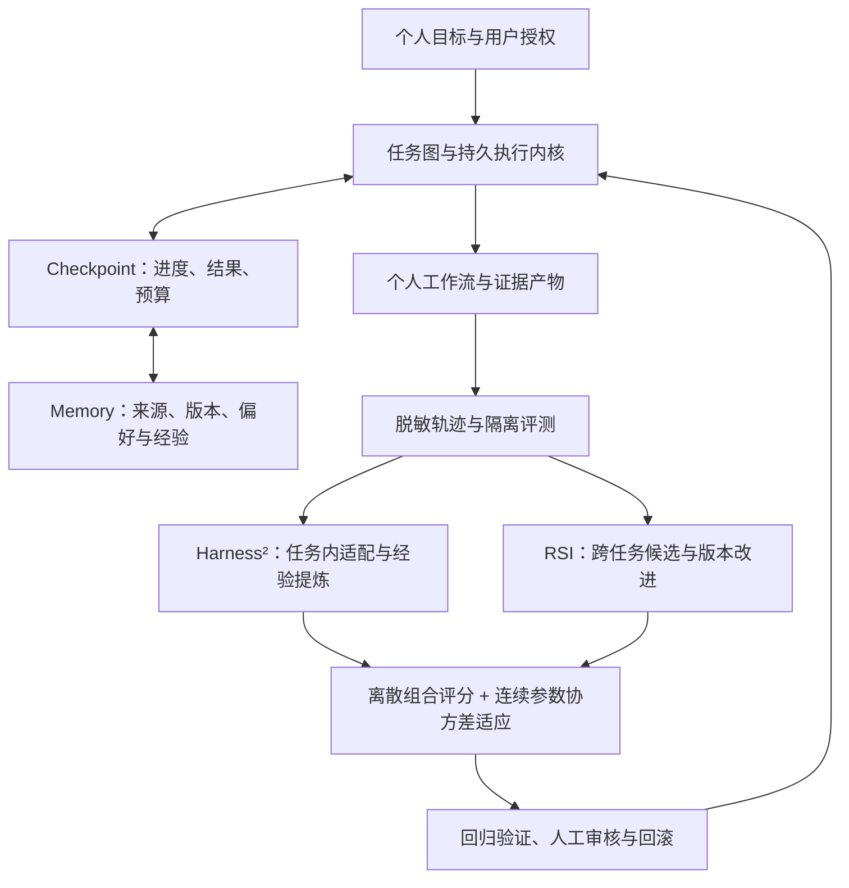

# Trail · Personal Agent Roadmap

> 更新：2026-11-11。规划入口：[#8](https://github.com/ydflow/Trail/issues/8) · [愿景讨论](https://github.com/ydflow/Trail/discussions/39) · [贡献指南](../CONTRIBUTING.md) · [能力地图](https://github.com/ydflow/Trail/issues/9)

## 愿景：从投研工作台走向真正的 Personal Agent

**让每一次研究成为下一次行动的起点，让每一个长期目标拥有可持续的执行上下文。**

Trail 希望成为个人与数字世界之间的长期协作层：既能理解目标与偏好，也能把任务推进到可核验的结果；既能在中断后继续，又能从经验中提炼更合适的工作方式。投研是起点，长期目标是服务个人研究、知识整理、项目推进与日常工作。

我们希望形成的价值飞轮是：**可靠执行积累可信轨迹 → 轨迹沉淀可控记忆 → 记忆帮助任务适配 → 经过评测的经验改善后续执行。**

> 状态：未来规划 / 研究议程。下列通用个人记忆、持久个人任务与自我改进体系尚未完整实现。阶段按验收结果推进，不承诺上线时间或必然性能提升。当前基础见能力地图。

## 四个阶段

| 阶段 | 希望交付的能力 | 完成信号 |
| --- | --- | --- |
| [M1 · Durable Personal Core](https://github.com/ydflow/Trail/milestone/1) | 参考 Pi Durable，统一任务图、checkpoint、工具重放与故障恢复 | 可重复的跨进程恢复；解释每个副作用的不确定边界 |
| [M2 · Memory × Checkpoint](https://github.com/ydflow/Trail/milestone/2) | 进度与记忆版本联合管理；偏好、事实、经历和方法可纠正、可遗忘 | 恢复不串版本，记忆有来源，删除不因旧任务而复活 |
| [M3 · Personal Workflows](https://github.com/ydflow/Trail/milestone/3) | 个人目标、任务收件箱、持久调度、授权连接器与每日简报 | 在真实授权场景中完成可追溯工作闭环，并记录成本和人工修订 |
| [R1 · Harness² × RSI Research](https://github.com/ydflow/Trail/milestone/4) | 双层递归适配、离散组合评分、连续参数协方差适应与受控晋升 | 留出集、等预算基线、消融与可复现实验支持结论，负结果同样公开 |

M1 是下一步优先级；M2/M3 在基础契约稳定后渐进展开。R1 的文献与离线实验可先讨论，实际融合依赖可靠执行、记忆与评测基础。

## 长期架构蓝图

图中是拟议架构，不代表这些模块已全部接通。

### 为什么 Checkpoint × Memory 是主线

Checkpoint 回答“做到哪里、哪些结果已经提交”；Memory 回答“用户是谁、依据什么、有哪些可复用经验”。融合需要联合版本、来源引用和冲突处理，而不只是把聊天摘要附到恢复文件。目标是在应用重启、用户纠正或目标变更后，仍能清楚解释继续执行的依据。

### Harness² × RSI 如何融合

- **任务内层**：参考 Harness² 的 Propose–Probe–Compose，让当前任务的执行方式进行有预算的适配，并提取适用条件。
- **跨任务层**：以受控 RSI 循环生成 prompt、skill、hook、流程或配置候选，经隔离评测、人工审核后版本化晋升。
- **离散选择层**：研究 Skill × Tool × Workflow × Model 的组合，显式约束兼容性、权限和费用；这不是证券组合优化。
- **连续优化层**：探索协方差矩阵适应，用于低维连续参数，如检索阈值或预算比例；类别选择仍由离散方法处理。
- **验证层**：分别测量正确性、证据、恢复、人工纠正、费用、延迟和权限违规。组合模块必须通过消融实验说明贡献。

这是 Trail 的工程研究提案。我们不会把协方差更新等同于智能递归提升，也不会把论文结果当作本项目结果。模型权重训练、无限制自改写和自动生产晋升均不属于当前研究交付。

## 任务索引

架构取舍与实验设计可先参与 [Pi Durable 讨论](https://github.com/ydflow/Trail/discussions/40)、[Checkpoint × Memory 讨论](https://github.com/ydflow/Trail/discussions/41)、[Harness² × RSI 讨论](https://github.com/ydflow/Trail/discussions/42) 和 [组合评分与协方差适应讨论](https://github.com/ydflow/Trail/discussions/43)。讨论结论回链到下列任务，实施与验收进度以 Issue/PR 为准。

勾选项已按对应 Issue 验收，未勾选项仍待推进。前置依赖、源码起点与最小贡献范围见各 Issue。

### M1 · Durable Personal Core

- [ ] [#10 · Pi Durable 适配：为 Personal Agent 建立持久执行内核](https://github.com/ydflow/Trail/issues/10)
- [ ] [#11 · 统一 Goal / Project / Task / Run / Step 状态与任务图](https://github.com/ydflow/Trail/issues/11)
- [ ] [#12 · 将 Checkpoint 扩展到普通助手与长任务](https://github.com/ydflow/Trail/issues/12)
- [ ] [#13 · 工具副作用日志与重放策略：区分读取、幂等写入和人工确认](https://github.com/ydflow/Trail/issues/13)
- [ ] [#14 · Durable 任务故障注入与恢复一致性测试矩阵](https://github.com/ydflow/Trail/issues/14)
- [ ] [#15 · 会话导入导出与重启后草稿恢复](https://github.com/ydflow/Trail/issues/15)
- [ ] [#34 · 补充开发启动与常见问题排查手册](https://github.com/ydflow/Trail/issues/34)
- [ ] [#35 · 研迹助手键盘操作、可访问性与窄窗口审计](https://github.com/ydflow/Trail/issues/35)
- [x] [#36 · 建立能力与 Provider 覆盖矩阵：让项目价值有证据可查](https://github.com/ydflow/Trail/issues/36)，已由 [PR #48](https://github.com/ydflow/Trail/pull/48) 交付，见[覆盖矩阵](provider-coverage-matrix.md)。

### M2 · Memory × Checkpoint

- [ ] [#16 · 个人长期记忆模型：偏好、事实、经历与方法](https://github.com/ydflow/Trail/issues/16)
- [ ] [#17 · Checkpoint × Memory 一致性：让恢复进度与记忆版本同步](https://github.com/ydflow/Trail/issues/17)
- [ ] [#18 · 记忆候选写入、用户确认与纠正入口](https://github.com/ydflow/Trail/issues/18)
- [ ] [#19 · 可解释检索基线：相关性、时效、来源与上下文预算](https://github.com/ydflow/Trail/issues/19)
- [ ] [#20 · 经历整合与经验提炼：保留原始证据的分层记忆](https://github.com/ydflow/Trail/issues/20)
- [ ] [#21 · 记忆遗忘、导出与派生数据失效机制](https://github.com/ydflow/Trail/issues/21)

### M3 · Personal Workflows

- [ ] [#22 · 个人目标与任务收件箱：从单次问答走向持续协作](https://github.com/ydflow/Trail/issues/22)
- [ ] [#23 · 持久调度：周期任务、时区与错过触发策略](https://github.com/ydflow/Trail/issues/23)
- [ ] [#24 · 个人资料能力适配层：先从本地文件与只读日历开始](https://github.com/ydflow/Trail/issues/24)
- [ ] [#25 · 个人每日简报：目标、待办与研究证据的统一视图](https://github.com/ydflow/Trail/issues/25)
- [ ] [#26 · 动作审批中心：预览、确认、执行结果与撤销边界](https://github.com/ydflow/Trail/issues/26)
- [ ] [#27 · 记忆地图与任务运行视图：看得见的个人助理状态](https://github.com/ydflow/Trail/issues/27)

### R1 · Harness² × RSI Research

- [ ] [#28 · 版本化任务轨迹与隔离评测集：为自我改进建立证据基座](https://github.com/ydflow/Trail/issues/28)
- [ ] [#29 · 离散组合评分：评估 Skill × Tool × Workflow × Model 的协同配置](https://github.com/ydflow/Trail/issues/29)
- [ ] [#30 · 协方差矩阵适应：探索连续 Harness 参数的递归优化](https://github.com/ydflow/Trail/issues/30)
- [ ] [#31 · Harness² 双层递归：任务内 Propose–Probe–Compose 与跨任务经验](https://github.com/ydflow/Trail/issues/31)
- [ ] [#32 · 受控 RSI 外循环：候选生成、沙箱评测、审核晋升与回滚](https://github.com/ydflow/Trail/issues/32)
- [ ] [#33 · Harness² × RSI 融合实验：离散组合、协方差适应与长期记忆的消融验证](https://github.com/ydflow/Trail/issues/33)

## 参与方式与研究来源

欢迎从接口设计、故障案例、离线夹具、交互审计与文档入手。先评论说明最小范围，再使用 `/claim` 认领；前置任务未完成时，可先做设计和 PoC，不承诺完整集成。

- [Pi Durable 官方文档](https://github.com/earendil-works/pi/blob/main/packages/durable/README.md)：参考持久执行设计；上游标为实验性，采用前需要固定版本并验证兼容性。其 MemoryStorage 不等于个人长期语义记忆。
- [Harness² 原论文 v1](https://arxiv.org/abs/2610.14224v1)：参考双层递归与任务内对比式修订。Trail 的评分与工程约束是待验证适配，不冒充原论文复现结果。
- [CMA-ES 官方资料](https://cma-es.github.io/)：连续黑盒优化方法的研究参考，是否适合 Trail 仍需对照实验。
